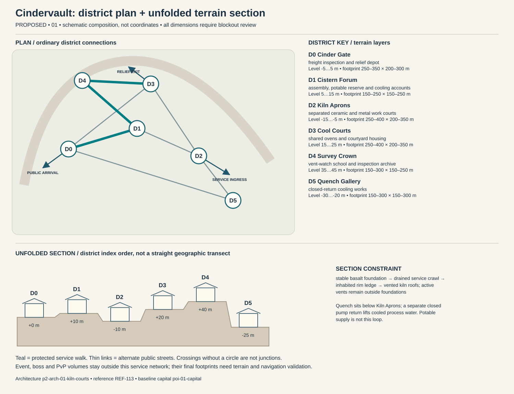

# Cindervault — capital construction blueprint

Status: PROPOSED. Sources: P2-SRC-FOUNDATION, P2-SRC-DIRECTIVE, P2-SRC-PROPOSAL. Capital ID poi-01-capital; region region-01. [Baseline dossier](https://github.com/jrmoyler/Aetherion-The-Fifteen-Oaths/tree/5dce9edae0bb3587eb7c72433395e7d5a19857ea/AETHERION_CANON/04_OATH_DOSSIERS/01_KILN_OATH.md). This plan refines the foundation; it is not an implemented city.

## Site and provisional dimensions

Cindervault occupies terraces on an old caldera rim, never an active lava lake. Civic cisterns and outward evacuation roads make its volcanic grandeur physically legible and expose unequal access to safe elevation.

Plan form: broken crescent on an extinct caldera rim. Orientation: outer-rim road east–west; work terraces step inward. Target outer envelope 1400 × 800 m; target maximum internal relief 65 m. All metres are provisional blockout targets. District rectangles overlap in vertical layers; they are envelopes, not cadastral parcels. Final terrain, grades, route lengths, capacity, accessibility and simulation require validation. Relative heights establish a first section for critique, not automatic street grades. Where an adjacency changes height, insert a validated ordinary ramp, conventional lift with evacuation fallback, or contour path; reject infeasible ramps rather than hiding them behind magic.

## District program and adjacency

Districts follow local functions and physical constraints. They are not independent towns, equal-population wards or asset-count quotas. Edges below are undirected public links, separate from optional shortcuts.

### Cinder Gate (p2-district-01-cinder-gate)

Function: freight inspection and relief depot. Functional envelope range 250–350 m wide × 200–300 m deep; relative terrain layer -5 to 5 m. This range follows the work, civic or household program and is not a property boundary. Direct neighbors: Cistern Forum, Quench Gallery, Cool Courts. Keep two independently signed public entries. Main thresholds show purpose and service availability before entry; private work yards cannot become a compulsory through-route. Use p2-arch-01-kiln-courts; fixtures follow the district function rather than generic elemental decoration.

### Cistern Forum (p2-district-01-cistern-forum)

Function: assembly, potable reserve and cooling accounts. Functional envelope range 150–250 m wide × 150–250 m deep; relative terrain layer 5 to 15 m. This range follows the work, civic or household program and is not a property boundary. Direct neighbors: Cinder Gate, Kiln Aprons, Survey Crown. Keep two independently signed public entries. Main thresholds show purpose and service availability before entry; private work yards cannot become a compulsory through-route. Use p2-arch-01-kiln-courts; fixtures follow the district function rather than generic elemental decoration.

### Kiln Aprons (p2-district-01-kiln-aprons)

Function: separated ceramic and metal work courts. Functional envelope range 250–400 m wide × 200–350 m deep; relative terrain layer -15 to -5 m. This range follows the work, civic or household program and is not a property boundary. Direct neighbors: Cistern Forum, Cool Courts, Quench Gallery. Keep two independently signed public entries. Main thresholds show purpose and service availability before entry; private work yards cannot become a compulsory through-route. Use p2-arch-01-kiln-courts; fixtures follow the district function rather than generic elemental decoration.

### Cool Courts (p2-district-01-cool-courts)

Function: shared ovens and courtyard housing. Functional envelope range 250–400 m wide × 200–350 m deep; relative terrain layer 15 to 25 m. This range follows the work, civic or household program and is not a property boundary. Direct neighbors: Kiln Aprons, Survey Crown, Cinder Gate. Keep two independently signed public entries. Main thresholds show purpose and service availability before entry; private work yards cannot become a compulsory through-route. Use p2-arch-01-kiln-courts; fixtures follow the district function rather than generic elemental decoration.

### Survey Crown (p2-district-01-survey-crown)

Function: vent-watch school and inspection archive. Functional envelope range 150–300 m wide × 150–250 m deep; relative terrain layer 35 to 45 m. This range follows the work, civic or household program and is not a property boundary. Direct neighbors: Cool Courts, Cistern Forum. Keep two independently signed public entries. Main thresholds show purpose and service availability before entry; private work yards cannot become a compulsory through-route. Use p2-arch-01-kiln-courts; fixtures follow the district function rather than generic elemental decoration.

### Quench Gallery (p2-district-01-quench-gallery)

Function: closed-return cooling works. Functional envelope range 150–300 m wide × 150–300 m deep; relative terrain layer -30 to -20 m. This range follows the work, civic or household program and is not a property boundary. Direct neighbors: Kiln Aprons, Cinder Gate. Keep two independently signed public entries. Main thresholds show purpose and service availability before entry; private work yards cannot become a compulsory through-route. Use p2-arch-01-kiln-courts; fixtures follow the district function rather than generic elemental decoration.

## Drawn plan and section

The diagram shows the actual district graph, separate public/logistics/relief entry points and the proposed terrain layers. Plan positions are diagram units, not map coordinates. The lower section unfolds the district sequence for inspection; it does not imply that every district is collinear. Terrain layer bands need site survey and accessible connecting paths.

## Streets, gates and access

Primary public arrival at Cinder Gate; separate logistics gate serves Kiln Aprons; an independently signed relief approach reaches Cool Courts. These are three conceptual connections pending placement. Arrival should reveal one civic landmark and a legible next decision, not every district at once. Public links target 5 m clear width, widened to 8 m at gate connections; test these with the eventual actor, cart and crowd envelopes. Ordinary door and assisted-route clearances must be measured in engine. Alternate paths need contrasting landmarks, not just different colored arrows.

## Service spine and logistics

ore and fuel enter at Cinder Gate; food crosses the outer-rim road to Cool Courts; spent quench water stays in a closed return; Quench Gallery lies below the kiln aprons, and inspected mechanical pumps return cooled process water uphill through a separate closed pipe. The protected route is Cinder Gate → Cistern Forum → Survey Crown → Cool Courts. It connects arrival services, civic counters and stable housing. Potable intake, process return and storm overflow cross only through inspectable sealed structures. Waste collection schedules avoid food queues; relief stores can be served with the specialist district closed. Event and territory states may change scenery or throughput but not remove this spine.

## Evacuation and failure paths

Each district has at least two graph exits. Walk outward via the shorter open graph arc to Cinder Gate; if its external approach fails, use the protected housing-side relief exit at Cool Courts. Never send residents through poi-01-event, p2-poi-01-worldboss or p2-poi-01-pvp. Dedicated staff move services before hazard closure. Two distinct external receiving points must be mapped before terrain lock. A biconnected district graph is only a paper check: hazard volumes, blocked doors, crowd congestion and external approach failures require independent runtime tests. Outpost warnings activate before gates close; first responders have a separate marked lane. Forced reset returns a visitor to the stable arrival refuge rather than an active hazard.

## Enterable interiors

- p2-poi-01-public-record-room: hearing desk, appeal archive, quiet waiting niche; target clear envelope 18 × 14 m. Public vestibule and independent service door; no key or hostile-state trap on the public route. Staff rotate; closed counters expose a staffed fallback kiosk without opening private storage.
- p2-poi-01-repair-interior: bench, supervised public tool rack, material store, separate waste exit; target clear envelope 24 × 18 m. Public vestibule and independent service door; no key or hostile-state trap on the public route. Staff rotate; closed counters expose a staffed fallback kiosk without opening private storage.
- p2-poi-01-watch-refuge: rotating guard station, civilian refuge, emergency stores, two exit doors; target clear envelope 22 × 16 m. Public vestibule and independent service door; no key or hostile-state trap on the public route. Staff rotate; closed counters expose a staffed fallback kiosk without opening private storage.

Housing: p2-poi-01-housing, entered from Cool Courts. Sample 12 × 10 m room and 4 × 3 m entrance/storage vestibule are test envelopes. Preserve safe storage access, permissions, and recovery independent of the external facade. Housing clusters around shared cool courts outside hazard corridors. Players can customize kilns and ceramics, but a protected workshop lease cannot block evacuation; relocation after an event preserves ownership and stored belongings.

## Vertical cross-section and underground

stable basalt foundation → drained service crawl → inhabited rim ledge → vented kiln roofs; active vents remain outside foundations. Occupied rooms need inspectable drainage/ventilation appropriate to their layer. Section drawings must show foundations, habitable floors, overhead loading, water and evacuation, not only a skyline.

Dungeon approach: dry inspection stair → flooded return-gallery overlook → inactive kiln hall → evidence office → outward rescue adit. The threshold to poi-01-dungeon is a signed, separate admission zone; public utility access does not flag a party into combat. The secret p2-poi-01-secret is optional and never hides the only exit.

## Institutions, livelihoods and defense

Workshop assemblies allocate furnace time; a basin council sets evacuation and river-temperature limits. Owners may appeal quotas, but no property title overrides a posted volcanic exclusion zone. Shared ovens reduce household fuel costs; shift meals and apprentice adoption networks organize neighborhoods. The covenant asks for maintenance service proportional to furnace access, with civic alternatives for people unable to work heat shifts. The gate watch uses p2-poi-01-watch-refuge with civilian refuge space protected from equipment loading. Specialist schools and care at Survey Crown have public counters; disputes affect negotiated services instead of magically disabling the whole city. Trade requires food, ore, cooling expertise and exports tools, refractory ceramics, specialist heat work. Regional villages and the exchange settlement supply daily evidence of these dependencies.

## Sacred and commemorative space

Open Crucible Alcove in Cistern Forum is a voluntary sacred/commemorative Oath space: voluntary remembrance of failed works and public repair promises; cooled broken ceramics are displayed with their makers’ consent. It occupies an accessible alcove or court inside the existing civic district, so it adds a distinct purpose without inventing another settlement. The ordinary public entrance remains open to unbound visitors, observers and dissenters; no prayer, ritual, ancestry, faction standing or Oath binding is required for civic services. A quiet side exit and nonparticipatory route preserve choice. Objects left here are authored story props, not automatic transfers of player possessions.

## Day/night, weather and NPC circulation

Dawn ash checks open work courts; midday heat pauses shift commerce into shaded galleries; night repair stalls operate at Ashbridge. Ash rain closes exposed kilns first; clean-water stores are covered before an outward evacuation.

Anchor existing character-01-leader to scheduled hearings at Cistern Forum; character-01-civilian moves between specialist work at Kiln Aprons, public testimony and home/rest without being respawned as another identity. New background roles are role slots, not invented named protagonists: village producer → exchange store → home; porter → gate → workshop → break; watch → outpost → relief → rest; custodian → institution → service lane. Dawn ash checks open work courts; midday heat pauses shift commerce into shaded galleries; night repair stalls operate at Ashbridge. During hazards, interrupt into warn/escort/refuge before resuming; bound simulation off-screen and never require a precise real-time appointment for story access.

Piston breaths, hand-hammer call-and-response and changing furnace draught communicate state. Evacuation alarms use a distinct tempo and tactile caption so musical intensity cannot mask an actionable safety signal. Alarm priority must override ambient masking without requiring hearing. Night lighting preserves route shape, household quiet and silhouette contrast; optional magic does not replace ordinary lamps, signs and staff.

## Event, world-boss and PvP interfaces

poi-01-event retains the baseline event catchment. Relief deployment goes to p2-district-01-cinder-gate before closures; p2-poi-01-worldboss stays outside homes and the service loop. p2-poi-01-pvp has a separate explicit opt-in entry and two withdrawal routes. A public procession can alter traffic through a predeclared loop; no event may consume both external receiving points. Homes retain interior/storage state and safe return.

## Reference and asset handoff

Architecture kit: p2-arch-01-kiln-courts; art guide art-guide-01; recovered reference REF-113. Verified foundation observation: Obsidian basalt terraces, vented foundry towers and lava-lit channels. Materials observed in the foundation: fired ceramic, oxidized iron, firecloth. New layouts translate that language into use-specific load paths and service fixtures; the reference is not proof of exact dimensions, unseen surfaces or individual production approval. Kit substitutions need an explicit compatibility and silhouette review.

## Construction phasing

1. P0: survey foundations, catchments and exclusion volumes; establish ordinary external route and temporary clean-water/refuge services.
2. P1: block out all district graph edges and two external refuge exits; reject any disconnected essential-service layout before visual work.
3. P2: build load-bearing kit, drainage, service separation, residential sample and three enterable service interiors; prove normal day/night paths.
4. P3: add optional vertical/special-Oath paths, bounded dungeon transitions, event closure overlays and habitat/resource margins without replacing public routes.
5. P4: add reference-reviewed material detail, sound and NPC routines; run disaster, accessibility, housing recovery and reduced-effects tests; obtain human signoff.

## Acceptance gates

- Graph remains connected after any one district-link closure; independently test external egress and no-Oath traversal in blockout.
- Deliver food, waste, emergency care and freight without entering optional PvP or a live boss footprint.
- Each occupied interior exposes two distinct exits and a stable safe return point.
- Change day/night, event recovery and territorial presentation without relocating protected service/housing IDs.
- Validate real gradients, sightlines, support, crowd capacity, collision, nav and render costs before claiming production readiness.

No asset count, population, street capacity, engineering safety, travel time or performance target is approved by this document. Validate the lean ordinary city first; only then add spectacle layers.
