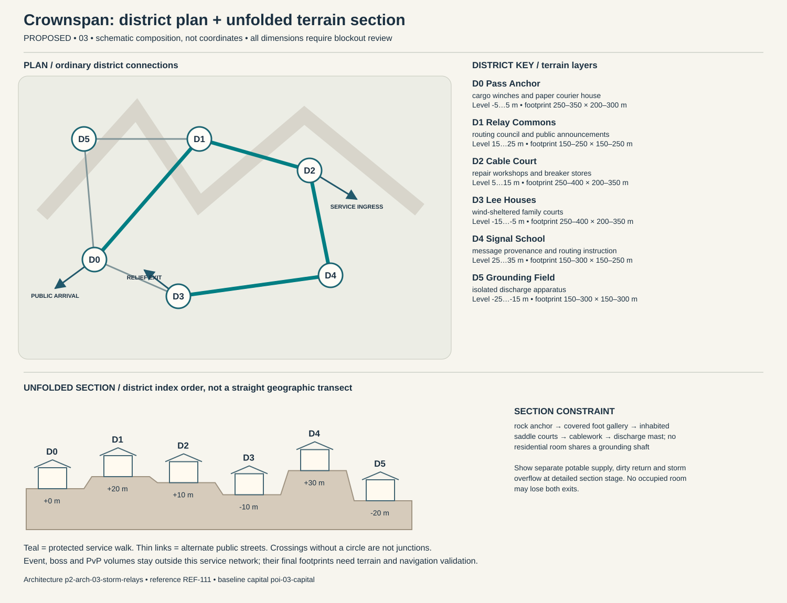

# Crownspan — capital construction blueprint

Status: PROPOSED. Sources: P2-SRC-FOUNDATION, P2-SRC-DIRECTIVE, P2-SRC-PROPOSAL. Capital ID poi-03-capital; region region-03. [Baseline dossier](https://github.com/jrmoyler/Aetherion-The-Fifteen-Oaths/tree/5dce9edae0bb3587eb7c72433395e7d5a19857ea/AETHERION_CANON/04_OATH_DOSSIERS/03_STORM_RELAY.md). This plan refines the foundation; it is not an implemented city.

## Site and provisional dimensions

Crownspan straddles several mountain saddles connected by protected cableways. Public squares sit away from discharge paths; dramatic suspended relay galleries are serviced from stable anchor towers and sheltered evacuation stairs.

Plan form: three anchored saddle clusters joined by a sheltered ground loop. Orientation: ridge service spine below cableways. Target outer envelope 1700 × 600 m; target maximum internal relief 50 m. All metres are provisional blockout targets. District rectangles overlap in vertical layers; they are envelopes, not cadastral parcels. Final terrain, grades, route lengths, capacity, accessibility and simulation require validation. Relative heights establish a first section for critique, not automatic street grades. Where an adjacency changes height, insert a validated ordinary ramp, conventional lift with evacuation fallback, or contour path; reject infeasible ramps rather than hiding them behind magic.

## District program and adjacency

Districts follow local functions and physical constraints. They are not independent towns, equal-population wards or asset-count quotas. Edges below are undirected public links, separate from optional shortcuts.

### Pass Anchor (p2-district-03-pass-anchor)

Function: cargo winches and paper courier house. Functional envelope range 250–350 m wide × 200–300 m deep; relative terrain layer -5 to 5 m. This range follows the work, civic or household program and is not a property boundary. Direct neighbors: Relay Commons, Lee Houses, Grounding Field. Keep two independently signed public entries. Main thresholds show purpose and service availability before entry; private work yards cannot become a compulsory through-route. Use p2-arch-03-storm-relays; fixtures follow the district function rather than generic elemental decoration.

### Relay Commons (p2-district-03-relay-commons)

Function: routing council and public announcements. Functional envelope range 150–250 m wide × 150–250 m deep; relative terrain layer 15 to 25 m. This range follows the work, civic or household program and is not a property boundary. Direct neighbors: Pass Anchor, Cable Court, Grounding Field. Keep two independently signed public entries. Main thresholds show purpose and service availability before entry; private work yards cannot become a compulsory through-route. Use p2-arch-03-storm-relays; fixtures follow the district function rather than generic elemental decoration.

### Cable Court (p2-district-03-cable-court)

Function: repair workshops and breaker stores. Functional envelope range 250–400 m wide × 200–350 m deep; relative terrain layer 5 to 15 m. This range follows the work, civic or household program and is not a property boundary. Direct neighbors: Relay Commons, Signal School. Keep two independently signed public entries. Main thresholds show purpose and service availability before entry; private work yards cannot become a compulsory through-route. Use p2-arch-03-storm-relays; fixtures follow the district function rather than generic elemental decoration.

### Lee Houses (p2-district-03-lee-houses)

Function: wind-sheltered family courts. Functional envelope range 250–400 m wide × 200–350 m deep; relative terrain layer -15 to -5 m. This range follows the work, civic or household program and is not a property boundary. Direct neighbors: Signal School, Pass Anchor. Keep two independently signed public entries. Main thresholds show purpose and service availability before entry; private work yards cannot become a compulsory through-route. Use p2-arch-03-storm-relays; fixtures follow the district function rather than generic elemental decoration.

### Signal School (p2-district-03-signal-school)

Function: message provenance and routing instruction. Functional envelope range 150–300 m wide × 150–250 m deep; relative terrain layer 25 to 35 m. This range follows the work, civic or household program and is not a property boundary. Direct neighbors: Cable Court, Lee Houses. Keep two independently signed public entries. Main thresholds show purpose and service availability before entry; private work yards cannot become a compulsory through-route. Use p2-arch-03-storm-relays; fixtures follow the district function rather than generic elemental decoration.

### Grounding Field (p2-district-03-grounding-field)

Function: isolated discharge apparatus. Functional envelope range 150–300 m wide × 150–300 m deep; relative terrain layer -25 to -15 m. This range follows the work, civic or household program and is not a property boundary. Direct neighbors: Relay Commons, Pass Anchor. Keep two independently signed public entries. Main thresholds show purpose and service availability before entry; private work yards cannot become a compulsory through-route. Use p2-arch-03-storm-relays; fixtures follow the district function rather than generic elemental decoration.

## Drawn plan and section

The diagram shows the actual district graph, separate public/logistics/relief entry points and the proposed terrain layers. Plan positions are diagram units, not map coordinates. The lower section unfolds the district sequence for inspection; it does not imply that every district is collinear. Terrain layer bands need site survey and accessible connecting paths.

## Streets, gates and access

Primary public arrival at Pass Anchor; separate logistics gate serves Cable Court; an independently signed relief approach reaches Lee Houses. These are three conceptual connections pending placement. Arrival should reveal one civic landmark and a legible next decision, not every district at once. Public links target 5 m clear width, widened to 8 m at gate connections; test these with the eventual actor, cart and crowd envelopes. Ordinary door and assisted-route clearances must be measured in engine. Alternate paths need contrasting landmarks, not just different colored arrows.

## Service spine and logistics

pack trains reach Pass Anchor beneath the cableways; manual porters bridge outage gaps; charged equipment travels separately from food and paper. The protected route is Pass Anchor → Relay Commons → Cable Court → Signal School → Lee Houses. It connects arrival services, civic counters and stable housing. Potable intake, process return and storm overflow cross only through inspectable sealed structures. Waste collection schedules avoid food queues; relief stores can be served with the specialist district closed. Event and territory states may change scenery or throughput but not remove this spine.

## Evacuation and failure paths

Each district has at least two graph exits. Walk outward via the shorter open graph arc to Pass Anchor; if its external approach fails, use the protected housing-side relief exit at Lee Houses. Never send residents through poi-03-event, p2-poi-03-worldboss or p2-poi-03-pvp. Dedicated staff move services before hazard closure. Two distinct external receiving points must be mapped before terrain lock. A biconnected district graph is only a paper check: hazard volumes, blocked doors, crowd congestion and external approach failures require independent runtime tests. Outpost warnings activate before gates close; first responders have a separate marked lane. Forced reset returns a visitor to the stable arrival refuge rather than an active hazard.

## Enterable interiors

- p2-poi-03-public-record-room: hearing desk, appeal archive, quiet waiting niche; target clear envelope 18 × 14 m. Public vestibule and independent service door; no key or hostile-state trap on the public route. Staff rotate; closed counters expose a staffed fallback kiosk without opening private storage.
- p2-poi-03-repair-interior: bench, supervised public tool rack, material store, separate waste exit; target clear envelope 24 × 18 m. Public vestibule and independent service door; no key or hostile-state trap on the public route. Staff rotate; closed counters expose a staffed fallback kiosk without opening private storage.
- p2-poi-03-watch-refuge: rotating guard station, civilian refuge, emergency stores, two exit doors; target clear envelope 22 × 16 m. Public vestibule and independent service door; no key or hostile-state trap on the public route. Staff rotate; closed counters expose a staffed fallback kiosk without opening private storage.

Housing: p2-poi-03-housing, entered from Lee Houses. Sample 12 × 10 m room and 4 × 3 m entrance/storage vestibule are test envelopes. Preserve safe storage access, permissions, and recovery independent of the external facade. Homes use shielded rooftop receivers and shared maintenance stairs. Players customize message rooms and workshops, but no private build can place lethal charge across public paths or harvest other players' communications.

## Vertical cross-section and underground

rock anchor → covered foot gallery → inhabited saddle courts → cablework → discharge mast; no residential room shares a grounding shaft. Occupied rooms need inspectable drainage/ventilation appropriate to their layer. Section drawings must show foundations, habitable floors, overhead loading, water and evacuation, not only a skyline.

Dungeon approach: manual dispatch room → abandoned routing decks → occupied repair refuge → loop-isolation chamber → sheltered cable-anchor stair. The threshold to poi-03-dungeon is a signed, separate admission zone; public utility access does not flag a party into combat. The secret p2-poi-03-secret is optional and never hides the only exit.

## Institutions, livelihoods and defense

Tower cooperatives elect delegates to a routing council; public emergency traffic has protected priority. Commercial operators seek exceptions, and local towers can resist central orders at the risk of breaking shared guarantees. Neighbors share public listening hours and teach verification of relayed information. Civic duty means keeping an addressable response point or staffing a fallback route, with privacy-protecting options for people fleeing persecution. The gate watch uses p2-poi-03-watch-refuge with civilian refuge space protected from equipment loading. Specialist schools and care at Signal School have public counters; disputes affect negotiated services instead of magically disabling the whole city. Trade requires insulators, structural parts, food and exports communications, weather services, routing. Regional villages and the exchange settlement supply daily evidence of these dependencies.

## Sacred and commemorative space

Unsent Bell Niche in Relay Commons is a voluntary sacred/commemorative Oath space: a hand-rung memorial for messages and travelers lost in storms, with a tactile dedication board and no mandatory broadcast. It occupies an accessible alcove or court inside the existing civic district, so it adds a distinct purpose without inventing another settlement. The ordinary public entrance remains open to unbound visitors, observers and dissenters; no prayer, ritual, ancestry, faction standing or Oath binding is required for civic services. A quiet side exit and nonparticipatory route preserve choice. Objects left here are authored story props, not automatic transfers of player possessions.

## Day/night, weather and NPC circulation

Dawn line crews inspect anchors; noon routing shifts overlap in Commons; night couriers retain paper delivery under load limits. Lightning disconnects optional sky decks; hand winches and covered stairs preserve essential service.

Anchor existing character-03-leader to scheduled hearings at Relay Commons; character-03-civilian moves between specialist work at Cable Court, public testimony and home/rest without being respawned as another identity. New background roles are role slots, not invented named protagonists: village producer → exchange store → home; porter → gate → workshop → break; watch → outpost → relief → rest; custodian → institution → service lane. Dawn line crews inspect anchors; noon routing shifts overlap in Commons; night couriers retain paper delivery under load limits. During hazards, interrupt into warn/escort/refuge before resuming; bound simulation off-screen and never require a precise real-time appointment for story access.

Short call-and-response pulses, cable resonance and a distant storm bed distinguish routing from alarms. UI transcribes signal intent, and dialogue remains intelligible under electrical spectacle. Alarm priority must override ambient masking without requiring hearing. Night lighting preserves route shape, household quiet and silhouette contrast; optional magic does not replace ordinary lamps, signs and staff.

## Event, world-boss and PvP interfaces

poi-03-event retains the baseline event catchment. Relief deployment goes to p2-district-03-pass-anchor before closures; p2-poi-03-worldboss stays outside homes and the service loop. p2-poi-03-pvp has a separate explicit opt-in entry and two withdrawal routes. A public procession can alter traffic through a predeclared loop; no event may consume both external receiving points. Homes retain interior/storage state and safe return.

## Reference and asset handoff

Architecture kit: p2-arch-03-storm-relays; art guide art-guide-03; recovered reference REF-111. Verified foundation observation: Mountain relay pylons, suspended conductive bridges and linked towers. Materials observed in the foundation: insulating cloth, copper, matte ceramic. New layouts translate that language into use-specific load paths and service fixtures; the reference is not proof of exact dimensions, unseen surfaces or individual production approval. Kit substitutions need an explicit compatibility and silhouette review.

## Construction phasing

1. P0: survey foundations, catchments and exclusion volumes; establish ordinary external route and temporary clean-water/refuge services.
2. P1: block out all district graph edges and two external refuge exits; reject any disconnected essential-service layout before visual work.
3. P2: build load-bearing kit, drainage, service separation, residential sample and three enterable service interiors; prove normal day/night paths.
4. P3: add optional vertical/special-Oath paths, bounded dungeon transitions, event closure overlays and habitat/resource margins without replacing public routes.
5. P4: add reference-reviewed material detail, sound and NPC routines; run disaster, accessibility, housing recovery and reduced-effects tests; obtain human signoff.

## Acceptance gates

- Graph remains connected after any one district-link closure; independently test external egress and no-Oath traversal in blockout.
- Deliver food, waste, emergency care and freight without entering optional PvP or a live boss footprint.
- Each occupied interior exposes two distinct exits and a stable safe return point.
- Change day/night, event recovery and territorial presentation without relocating protected service/housing IDs.
- Validate real gradients, sightlines, support, crowd capacity, collision, nav and render costs before claiming production readiness.

No asset count, population, street capacity, engineering safety, travel time or performance target is approved by this document. Validate the lean ordinary city first; only then add spectacle layers.
