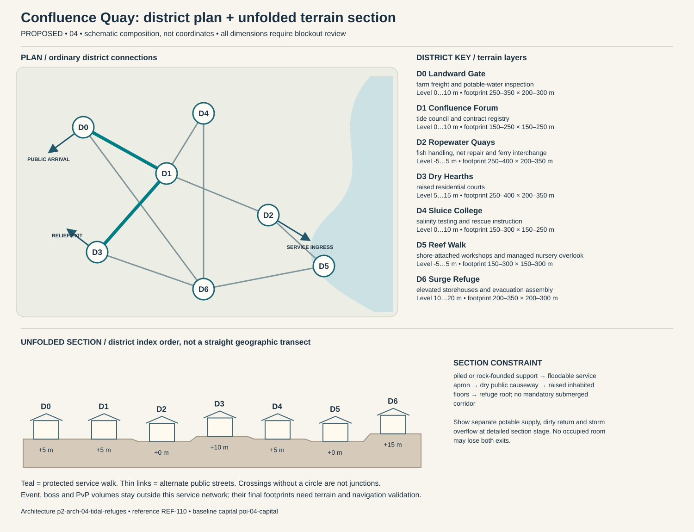

# Confluence Quay — capital construction blueprint

Status: PROPOSED. Sources: P2-SRC-FOUNDATION, P2-SRC-DIRECTIVE, P2-SRC-PROPOSAL. Capital ID poi-04-capital; region region-04. [Baseline dossier](https://github.com/jrmoyler/Aetherion-The-Fifteen-Oaths/tree/5dce9edae0bb3587eb7c72433395e7d5a19857ea/AETHERION_CANON/04_OATH_DOSSIERS/04_TIDAL_COVENANT.md). This plan refines the foundation; it is not an implemented city.

## Site and provisional dimensions

Confluence Quay is a mainland estuary city with shore-attached reef districts and navigable canals. Reef-city imagery never creates disconnected realm islands; occupied reefs connect by maintained causeways and accessible ferries.

Plan form: mainland canal fan with attached reef fingers. Orientation: freshwater-to-estuary gradient; elevated land causeway stays continuous. Target outer envelope 1700 × 1300 m; target maximum internal relief 15 m. All metres are provisional blockout targets. District rectangles overlap in vertical layers; they are envelopes, not cadastral parcels. Final terrain, grades, route lengths, capacity, accessibility and simulation require validation. Relative heights establish a first section for critique, not automatic street grades. Where an adjacency changes height, insert a validated ordinary ramp, conventional lift with evacuation fallback, or contour path; reject infeasible ramps rather than hiding them behind magic.

## District program and adjacency

Districts follow local functions and physical constraints. They are not independent towns, equal-population wards or asset-count quotas. Edges below are undirected public links, separate from optional shortcuts.

### Landward Gate (p2-district-04-landward-gate)

Function: farm freight and potable-water inspection. Functional envelope range 250–350 m wide × 200–300 m deep; relative terrain layer 0 to 10 m. This range follows the work, civic or household program and is not a property boundary. Direct neighbors: Confluence Forum, Surge Refuge. Keep two independently signed public entries. Main thresholds show purpose and service availability before entry; private work yards cannot become a compulsory through-route. Use p2-arch-04-tidal-refuges; fixtures follow the district function rather than generic elemental decoration.

### Confluence Forum (p2-district-04-confluence-forum)

Function: tide council and contract registry. Functional envelope range 150–250 m wide × 150–250 m deep; relative terrain layer 0 to 10 m. This range follows the work, civic or household program and is not a property boundary. Direct neighbors: Landward Gate, Ropewater Quays, Dry Hearths, Sluice College. Keep two independently signed public entries. Main thresholds show purpose and service availability before entry; private work yards cannot become a compulsory through-route. Use p2-arch-04-tidal-refuges; fixtures follow the district function rather than generic elemental decoration.

### Ropewater Quays (p2-district-04-ropewater-quays)

Function: fish handling, net repair and ferry interchange. Functional envelope range 250–400 m wide × 200–350 m deep; relative terrain layer -5 to 5 m. This range follows the work, civic or household program and is not a property boundary. Direct neighbors: Confluence Forum, Reef Walk. Keep two independently signed public entries. Main thresholds show purpose and service availability before entry; private work yards cannot become a compulsory through-route. Use p2-arch-04-tidal-refuges; fixtures follow the district function rather than generic elemental decoration.

### Dry Hearths (p2-district-04-dry-hearths)

Function: raised residential courts. Functional envelope range 250–400 m wide × 200–350 m deep; relative terrain layer 5 to 15 m. This range follows the work, civic or household program and is not a property boundary. Direct neighbors: Surge Refuge, Confluence Forum. Keep two independently signed public entries. Main thresholds show purpose and service availability before entry; private work yards cannot become a compulsory through-route. Use p2-arch-04-tidal-refuges; fixtures follow the district function rather than generic elemental decoration.

### Sluice College (p2-district-04-sluice-college)

Function: salinity testing and rescue instruction. Functional envelope range 150–300 m wide × 150–250 m deep; relative terrain layer 0 to 10 m. This range follows the work, civic or household program and is not a property boundary. Direct neighbors: Confluence Forum, Surge Refuge. Keep two independently signed public entries. Main thresholds show purpose and service availability before entry; private work yards cannot become a compulsory through-route. Use p2-arch-04-tidal-refuges; fixtures follow the district function rather than generic elemental decoration.

### Reef Walk (p2-district-04-reef-walk)

Function: shore-attached workshops and managed nursery overlook. Functional envelope range 150–300 m wide × 150–300 m deep; relative terrain layer -5 to 5 m. This range follows the work, civic or household program and is not a property boundary. Direct neighbors: Ropewater Quays, Surge Refuge. Keep two independently signed public entries. Main thresholds show purpose and service availability before entry; private work yards cannot become a compulsory through-route. Use p2-arch-04-tidal-refuges; fixtures follow the district function rather than generic elemental decoration.

### Surge Refuge (p2-district-04-surge-refuge)

Function: elevated storehouses and evacuation assembly. Functional envelope range 200–350 m wide × 200–300 m deep; relative terrain layer 10 to 20 m. This range follows the work, civic or household program and is not a property boundary. Direct neighbors: Reef Walk, Dry Hearths, Sluice College, Landward Gate. Keep two independently signed public entries. Main thresholds show purpose and service availability before entry; private work yards cannot become a compulsory through-route. Use p2-arch-04-tidal-refuges; fixtures follow the district function rather than generic elemental decoration.

## Drawn plan and section

The diagram shows the actual district graph, separate public/logistics/relief entry points and the proposed terrain layers. Plan positions are diagram units, not map coordinates. The lower section unfolds the district sequence for inspection; it does not imply that every district is collinear. Terrain layer bands need site survey and accessible connecting paths.

## Streets, gates and access

Primary public arrival at Landward Gate; separate logistics gate serves Ropewater Quays; an independently signed relief approach reaches Dry Hearths. These are three conceptual connections pending placement. Arrival should reveal one civic landmark and a legible next decision, not every district at once. Public links target 5 m clear width, widened to 8 m at gate connections; test these with the eventual actor, cart and crowd envelopes. Ordinary door and assisted-route clearances must be measured in engine. Alternate paths need contrasting landmarks, not just different colored arrows.

## Service spine and logistics

farm carts enter landward; fish loads enter Ropewater; salt and potable stores remain separate; relief boats berth at Surge Refuge without crossing boss waters. The protected route is Landward Gate → Confluence Forum → Dry Hearths. It connects arrival services, civic counters and stable housing. Potable intake, process return and storm overflow cross only through inspectable sealed structures. Waste collection schedules avoid food queues; relief stores can be served with the specialist district closed. Event and territory states may change scenery or throughput but not remove this spine.

## Evacuation and failure paths

Each district has at least two graph exits. Walk outward via the shorter open graph arc to Landward Gate; if its external approach fails, use the protected housing-side relief exit at Dry Hearths. Never send residents through poi-04-event, p2-poi-04-worldboss or p2-poi-04-pvp. Dedicated staff move services before hazard closure. Two distinct external receiving points must be mapped before terrain lock. A biconnected district graph is only a paper check: hazard volumes, blocked doors, crowd congestion and external approach failures require independent runtime tests. Outpost warnings activate before gates close; first responders have a separate marked lane. Forced reset returns a visitor to the stable arrival refuge rather than an active hazard.

## Enterable interiors

- p2-poi-04-public-record-room: hearing desk, appeal archive, quiet waiting niche; target clear envelope 18 × 14 m. Public vestibule and independent service door; no key or hostile-state trap on the public route. Staff rotate; closed counters expose a staffed fallback kiosk without opening private storage.
- p2-poi-04-repair-interior: bench, supervised public tool rack, material store, separate waste exit; target clear envelope 24 × 18 m. Public vestibule and independent service door; no key or hostile-state trap on the public route. Staff rotate; closed counters expose a staffed fallback kiosk without opening private storage.
- p2-poi-04-watch-refuge: rotating guard station, civilian refuge, emergency stores, two exit doors; target clear envelope 22 × 16 m. Public vestibule and independent service door; no key or hostile-state trap on the public route. Staff rotate; closed counters expose a staffed fallback kiosk without opening private storage.

Housing: p2-poi-04-housing, entered from Dry Hearths. Sample 12 × 10 m room and 4 × 3 m entrance/storage vestibule are test envelopes. Preserve safe storage access, permissions, and recovery independent of the external facade. Homes have floodable ground utility floors and protected living levels. Canal plots include maintenance easements, and event damage changes repair tasks rather than permanently deleting stored furniture or blocking residents from their property.

## Vertical cross-section and underground

piled or rock-founded support → floodable service apron → dry public causeway → raised inhabited floors → refuge roof; no mandatory submerged corridor. Occupied rooms need inspectable drainage/ventilation appropriate to their layer. Section drawings must show foundations, habitable floors, overhead loading, water and evacuation, not only a skyline.

Dungeon approach: shore records office → air refuge → sluice control overlook → relief archive → landward inspection stair. The threshold to poi-04-dungeon is a signed, separate admission zone; public utility access does not flag a party into combat. The secret p2-poi-04-secret is optional and never hides the only exit.

## Institutions, livelihoods and defense

Watershed assemblies give upstream and downstream settlements a voice; harbor houses manage navigation separately. Drought arbitration requires public flow records so maritime wealth cannot silently overrule drinking-water needs. Public washing courts, shared cooking water and boat repair shape everyday encounters. Obligation is a measurable maintenance share with hardship relief; hereditary debt is a contested institution, never a natural law of the element. The gate watch uses p2-poi-04-watch-refuge with civilian refuge space protected from equipment loading. Specialist schools and care at Sluice College have public counters; disputes affect negotiated services instead of magically disabling the whole city. Trade requires grain, timber, durable tools and exports shipping, fisheries, hydraulics. Regional villages and the exchange settlement supply daily evidence of these dependencies.

## Sacred and commemorative space

Returning Cup Court in Confluence Forum is a voluntary sacred/commemorative Oath space: a freshwater gratitude rite beside a symbolic sealed basin; it never consumes the emergency potable reserve. It occupies an accessible alcove or court inside the existing civic district, so it adds a distinct purpose without inventing another settlement. The ordinary public entrance remains open to unbound visitors, observers and dissenters; no prayer, ritual, ancestry, faction standing or Oath binding is required for civic services. A quiet side exit and nonparticipatory route preserve choice. Objects left here are authored story props, not automatic transfers of player possessions.

## Day/night, weather and NPC circulation

Tide state schedules dock labor; midday salinity sampling can hold cargo; evening repair markets follow land access even when ferries stop. Surge closes reef work fingers sequentially; raised landward causeway remains until authored evacuation completes.

Anchor existing character-04-leader to scheduled hearings at Confluence Forum; character-04-civilian moves between specialist work at Ropewater Quays, public testimony and home/rest without being respawned as another identity. New background roles are role slots, not invented named protagonists: village producer → exchange store → home; porter → gate → workshop → break; watch → outpost → relief → rest; custodian → institution → service lane. Tide state schedules dock labor; midday salinity sampling can hold cargo; evening repair markets follow land access even when ferries stop. During hazards, interrupt into warn/escort/refuge before resuming; bound simulation off-screen and never require a precise real-time appointment for story access.

Overlapping channel rhythms, low dock percussion and human work songs anchor the sound. The tide-warning pattern is distinct from Observatory tones, reinforcing the two institutions' separate identities. Alarm priority must override ambient masking without requiring hearing. Night lighting preserves route shape, household quiet and silhouette contrast; optional magic does not replace ordinary lamps, signs and staff.

## Event, world-boss and PvP interfaces

poi-04-event retains the baseline event catchment. Relief deployment goes to p2-district-04-landward-gate before closures; p2-poi-04-worldboss stays outside homes and the service loop. p2-poi-04-pvp has a separate explicit opt-in entry and two withdrawal routes. A public procession can alter traffic through a predeclared loop; no event may consume both external receiving points. Homes retain interior/storage state and safe return.

## Reference and asset handoff

Architecture kit: p2-arch-04-tidal-refuges; art guide art-guide-04; recovered reference REF-110. Verified foundation observation: Pale coastal aqueduct terraces, shell arches and canal gates. Materials observed in the foundation: diving cloth, nacre shell, brass, clear reservoir glass. New layouts translate that language into use-specific load paths and service fixtures; the reference is not proof of exact dimensions, unseen surfaces or individual production approval. Kit substitutions need an explicit compatibility and silhouette review.

## Construction phasing

1. P0: survey foundations, catchments and exclusion volumes; establish ordinary external route and temporary clean-water/refuge services.
2. P1: block out all district graph edges and two external refuge exits; reject any disconnected essential-service layout before visual work.
3. P2: build load-bearing kit, drainage, service separation, residential sample and three enterable service interiors; prove normal day/night paths.
4. P3: add optional vertical/special-Oath paths, bounded dungeon transitions, event closure overlays and habitat/resource margins without replacing public routes.
5. P4: add reference-reviewed material detail, sound and NPC routines; run disaster, accessibility, housing recovery and reduced-effects tests; obtain human signoff.

## Acceptance gates

- Graph remains connected after any one district-link closure; independently test external egress and no-Oath traversal in blockout.
- Deliver food, waste, emergency care and freight without entering optional PvP or a live boss footprint.
- Each occupied interior exposes two distinct exits and a stable safe return point.
- Change day/night, event recovery and territorial presentation without relocating protected service/housing IDs.
- Validate real gradients, sightlines, support, crowd capacity, collision, nav and render costs before claiming production readiness.

No asset count, population, street capacity, engineering safety, travel time or performance target is approved by this document. Validate the lean ordinary city first; only then add spectacle layers.
