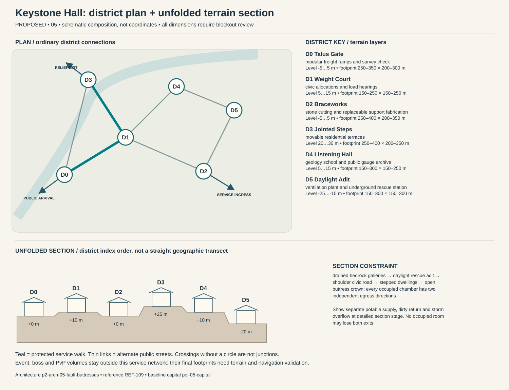

# Keystone Hall — capital construction blueprint

Status: PROPOSED. Sources: P2-SRC-FOUNDATION, P2-SRC-DIRECTIVE, P2-SRC-PROPOSAL. Capital ID poi-05-capital; region region-05. [Baseline dossier](https://github.com/jrmoyler/Aetherion-The-Fifteen-Oaths/tree/5dce9edae0bb3587eb7c72433395e7d5a19857ea/AETHERION_CANON/04_OATH_DOSSIERS/05_FAULT_CHOIR.md). This plan refines the foundation; it is not an implemented city.

## Site and provisional dimensions

Keystone Hall occupies a broad canyon shoulder anchored to surveyed bedrock. Deep chambers are civic workspaces, not an excuse to remove ventilation, drainage, emergency exits or accessible vertical transport.

Plan form: canyon shoulder with stepped buttress courts and two daylight adits. Orientation: load-bearing shoulder road across contour; deep chambers under surveyed rock only. Target outer envelope 1300 × 900 m; target maximum internal relief 45 m. All metres are provisional blockout targets. District rectangles overlap in vertical layers; they are envelopes, not cadastral parcels. Final terrain, grades, route lengths, capacity, accessibility and simulation require validation. Relative heights establish a first section for critique, not automatic street grades. Where an adjacency changes height, insert a validated ordinary ramp, conventional lift with evacuation fallback, or contour path; reject infeasible ramps rather than hiding them behind magic.

## District program and adjacency

Districts follow local functions and physical constraints. They are not independent towns, equal-population wards or asset-count quotas. Edges below are undirected public links, separate from optional shortcuts.

### Talus Gate (p2-district-05-talus-gate)

Function: modular freight ramps and survey check. Functional envelope range 250–350 m wide × 200–300 m deep; relative terrain layer -5 to 5 m. This range follows the work, civic or household program and is not a property boundary. Direct neighbors: Weight Court, Jointed Steps. Keep two independently signed public entries. Main thresholds show purpose and service availability before entry; private work yards cannot become a compulsory through-route. Use p2-arch-05-fault-buttresses; fixtures follow the district function rather than generic elemental decoration.

### Weight Court (p2-district-05-weight-court)

Function: civic allocations and load hearings. Functional envelope range 150–250 m wide × 150–250 m deep; relative terrain layer 5 to 15 m. This range follows the work, civic or household program and is not a property boundary. Direct neighbors: Talus Gate, Braceworks, Listening Hall, Jointed Steps. Keep two independently signed public entries. Main thresholds show purpose and service availability before entry; private work yards cannot become a compulsory through-route. Use p2-arch-05-fault-buttresses; fixtures follow the district function rather than generic elemental decoration.

### Braceworks (p2-district-05-braceworks)

Function: stone cutting and replaceable support fabrication. Functional envelope range 250–400 m wide × 200–350 m deep; relative terrain layer -5 to 5 m. This range follows the work, civic or household program and is not a property boundary. Direct neighbors: Weight Court, Daylight Adit. Keep two independently signed public entries. Main thresholds show purpose and service availability before entry; private work yards cannot become a compulsory through-route. Use p2-arch-05-fault-buttresses; fixtures follow the district function rather than generic elemental decoration.

### Jointed Steps (p2-district-05-jointed-steps)

Function: movable residential terraces. Functional envelope range 250–400 m wide × 200–350 m deep; relative terrain layer 20 to 30 m. This range follows the work, civic or household program and is not a property boundary. Direct neighbors: Weight Court, Talus Gate. Keep two independently signed public entries. Main thresholds show purpose and service availability before entry; private work yards cannot become a compulsory through-route. Use p2-arch-05-fault-buttresses; fixtures follow the district function rather than generic elemental decoration.

### Listening Hall (p2-district-05-listening-hall)

Function: geology school and public gauge archive. Functional envelope range 150–300 m wide × 150–250 m deep; relative terrain layer 5 to 15 m. This range follows the work, civic or household program and is not a property boundary. Direct neighbors: Daylight Adit, Weight Court. Keep two independently signed public entries. Main thresholds show purpose and service availability before entry; private work yards cannot become a compulsory through-route. Use p2-arch-05-fault-buttresses; fixtures follow the district function rather than generic elemental decoration.

### Daylight Adit (p2-district-05-daylight-adit)

Function: ventilation plant and underground rescue station. Functional envelope range 150–300 m wide × 150–300 m deep; relative terrain layer -25 to -15 m. This range follows the work, civic or household program and is not a property boundary. Direct neighbors: Braceworks, Listening Hall. Keep two independently signed public entries. Main thresholds show purpose and service availability before entry; private work yards cannot become a compulsory through-route. Use p2-arch-05-fault-buttresses; fixtures follow the district function rather than generic elemental decoration.

## Drawn plan and section

The diagram shows the actual district graph, separate public/logistics/relief entry points and the proposed terrain layers. Plan positions are diagram units, not map coordinates. The lower section unfolds the district sequence for inspection; it does not imply that every district is collinear. Terrain layer bands need site survey and accessible connecting paths.

## Streets, gates and access

Primary public arrival at Talus Gate; separate logistics gate serves Braceworks; an independently signed relief approach reaches Jointed Steps. These are three conceptual connections pending placement. Arrival should reveal one civic landmark and a legible next decision, not every district at once. Public links target 5 m clear width, widened to 8 m at gate connections; test these with the eventual actor, cart and crowd envelopes. Ordinary door and assisted-route clearances must be measured in engine. Alternate paths need contrasting landmarks, not just different colored arrows.

## Service spine and logistics

ore is weighed before Weight Court; heavy stone stays on a lower contour road; food carts use a separate upper terrace; spoil never fills natural drainage. The protected route is Talus Gate → Weight Court → Jointed Steps. It connects arrival services, civic counters and stable housing. Potable intake, process return and storm overflow cross only through inspectable sealed structures. Waste collection schedules avoid food queues; relief stores can be served with the specialist district closed. Event and territory states may change scenery or throughput but not remove this spine.

## Evacuation and failure paths

Each district has at least two graph exits. Walk outward via the shorter open graph arc to Talus Gate; if its external approach fails, use the protected housing-side relief exit at Jointed Steps. Never send residents through poi-05-event, p2-poi-05-worldboss or p2-poi-05-pvp. Dedicated staff move services before hazard closure. Two distinct external receiving points must be mapped before terrain lock. A biconnected district graph is only a paper check: hazard volumes, blocked doors, crowd congestion and external approach failures require independent runtime tests. Outpost warnings activate before gates close; first responders have a separate marked lane. Forced reset returns a visitor to the stable arrival refuge rather than an active hazard.

## Enterable interiors

- p2-poi-05-public-record-room: hearing desk, appeal archive, quiet waiting niche; target clear envelope 18 × 14 m. Public vestibule and independent service door; no key or hostile-state trap on the public route. Staff rotate; closed counters expose a staffed fallback kiosk without opening private storage.
- p2-poi-05-repair-interior: bench, supervised public tool rack, material store, separate waste exit; target clear envelope 24 × 18 m. Public vestibule and independent service door; no key or hostile-state trap on the public route. Staff rotate; closed counters expose a staffed fallback kiosk without opening private storage.
- p2-poi-05-watch-refuge: rotating guard station, civilian refuge, emergency stores, two exit doors; target clear envelope 22 × 16 m. Public vestibule and independent service door; no key or hostile-state trap on the public route. Staff rotate; closed counters expose a staffed fallback kiosk without opening private storage.

Housing: p2-poi-05-housing, entered from Jointed Steps. Sample 12 × 10 m room and 4 × 3 m entrance/storage vestibule are test envelopes. Preserve safe storage access, permissions, and recovery independent of the external facade. Housing uses adaptable terrace modules with inspectable load budgets. Players decorate within safe envelopes; structural failures route through repairable instance states and never allow another player to undermine a neighbor's stored home.

## Vertical cross-section and underground

drained bedrock galleries → daylight rescue adit → shoulder civic road → stepped dwellings → open buttress crown; every occupied chamber has two independent egress directions. Occupied rooms need inspectable drainage/ventilation appropriate to their layer. Section drawings must show foundations, habitable floors, overhead loading, water and evacuation, not only a skyline.

Dungeon approach: survey gate → worker shelter → counterweight chamber → load allocation archive → second daylight adit. The threshold to poi-05-dungeon is a signed, separate admission zone; public utility access does not flag a party into combat. The secret p2-poi-05-secret is optional and never hides the only exit.

## Institutions, livelihoods and defense

Terrace councils govern locally, while a load assembly certifies changes affecting shared foundations. Appeals require independent surveys, creating conflict when the institution that defines safe evidence also controls survey training. Public maintenance days repair paths and exchange grievances around common load maps. Civic obligation is contributing to shared structural safety; caste-like inherited assignments are a contested abuse of that principle. The gate watch uses p2-poi-05-watch-refuge with civilian refuge space protected from equipment loading. Specialist schools and care at Listening Hall have public counters; disputes affect negotiated services instead of magically disabling the whole city. Trade requires tool steels, food diversity, message hardware and exports ore, crystal instruments, structural surveying. Regional villages and the exchange settlement supply daily evidence of these dependencies.

## Sacred and commemorative space

Unburdened Stone Recess in Weight Court is a voluntary sacred/commemorative Oath space: a voluntary laying-down of a small load to remember workers and renegotiate burdens; no structural counterweight is moved. It occupies an accessible alcove or court inside the existing civic district, so it adds a distinct purpose without inventing another settlement. The ordinary public entrance remains open to unbound visitors, observers and dissenters; no prayer, ritual, ancestry, faction standing or Oath binding is required for civic services. A quiet side exit and nonparticipatory route preserve choice. Objects left here are authored story props, not automatic transfers of player possessions.

## Day/night, weather and NPC circulation

Dawn gauges authorize quarry shifts; noon hearings reconcile loads; night machinery quiets near houses while small-tool repairs continue. Heavy rain stops exposed cutting and raises seepage watches; contour bypass opens before lower adits close.

Anchor existing character-05-leader to scheduled hearings at Weight Court; character-05-civilian moves between specialist work at Braceworks, public testimony and home/rest without being respawned as another identity. New background roles are role slots, not invented named protagonists: village producer → exchange store → home; porter → gate → workshop → break; watch → outpost → relief → rest; custodian → institution → service lane. Dawn gauges authorize quarry shifts; noon hearings reconcile loads; night machinery quiets near houses while small-tool repairs continue. During hazards, interrupt into warn/escort/refuge before resuming; bound simulation off-screen and never require a precise real-time appointment for story access.

Layered low resonance, stone-on-stone work rhythms and small tool clicks establish scale. Dangerous stress has an accessible visual gauge, avoiding a puzzle whose entire solution depends on hearing a subtle bass frequency. Alarm priority must override ambient masking without requiring hearing. Night lighting preserves route shape, household quiet and silhouette contrast; optional magic does not replace ordinary lamps, signs and staff.

## Event, world-boss and PvP interfaces

poi-05-event retains the baseline event catchment. Relief deployment goes to p2-district-05-talus-gate before closures; p2-poi-05-worldboss stays outside homes and the service loop. p2-poi-05-pvp has a separate explicit opt-in entry and two withdrawal routes. A public procession can alter traffic through a predeclared loop; no event may consume both external receiving points. Homes retain interior/storage state and safe return.

## Reference and asset handoff

Architecture kit: p2-arch-05-fault-buttresses; art guide art-guide-05; recovered reference REF-109. Verified foundation observation: Canyon terraces, broad lintels and crystal-seamed retaining walls. Materials observed in the foundation: layered shale, sandstone, leather, raw amethyst. New layouts translate that language into use-specific load paths and service fixtures; the reference is not proof of exact dimensions, unseen surfaces or individual production approval. Kit substitutions need an explicit compatibility and silhouette review.

## Construction phasing

1. P0: survey foundations, catchments and exclusion volumes; establish ordinary external route and temporary clean-water/refuge services.
2. P1: block out all district graph edges and two external refuge exits; reject any disconnected essential-service layout before visual work.
3. P2: build load-bearing kit, drainage, service separation, residential sample and three enterable service interiors; prove normal day/night paths.
4. P3: add optional vertical/special-Oath paths, bounded dungeon transitions, event closure overlays and habitat/resource margins without replacing public routes.
5. P4: add reference-reviewed material detail, sound and NPC routines; run disaster, accessibility, housing recovery and reduced-effects tests; obtain human signoff.

## Acceptance gates

- Graph remains connected after any one district-link closure; independently test external egress and no-Oath traversal in blockout.
- Deliver food, waste, emergency care and freight without entering optional PvP or a live boss footprint.
- Each occupied interior exposes two distinct exits and a stable safe return point.
- Change day/night, event recovery and territorial presentation without relocating protected service/housing IDs.
- Validate real gradients, sightlines, support, crowd capacity, collision, nav and render costs before claiming production readiness.

No asset count, population, street capacity, engineering safety, travel time or performance target is approved by this document. Validate the lean ordinary city first; only then add spectacle layers.
