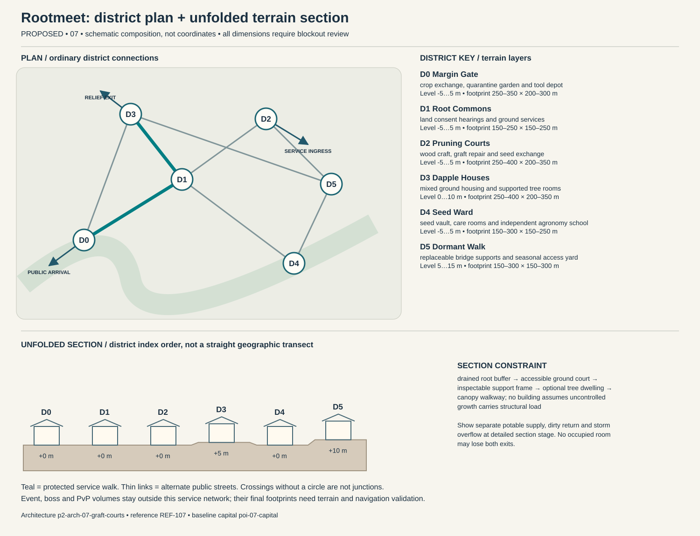

# Rootmeet — capital construction blueprint

Status: PROPOSED. Sources: P2-SRC-FOUNDATION, P2-SRC-DIRECTIVE, P2-SRC-PROPOSAL. Capital ID poi-07-capital; region region-07. [Baseline dossier](https://github.com/jrmoyler/Aetherion-The-Fifteen-Oaths/tree/5dce9edae0bb3587eb7c72433395e7d5a19857ea/AETHERION_CANON/04_OATH_DOSSIERS/07_GRAFT_SANCTUARY.md). This plan refines the foundation; it is not an implemented city.

## Site and provisional dimensions

Rootmeet grows around several connected mature trees with inspectable structural supports and ground-level services. Living bridges have dormant-season backups; sap flow and canopy light place real limits on expansion.

Plan form: ground-connected tree clusters around a permeable commons. Orientation: drainage swales through a ground ring; canopy branches form optional upper loops. Target outer envelope 1600 × 1200 m; target maximum internal relief 10 m. All metres are provisional blockout targets. District rectangles overlap in vertical layers; they are envelopes, not cadastral parcels. Final terrain, grades, route lengths, capacity, accessibility and simulation require validation. Relative heights establish a first section for critique, not automatic street grades. Where an adjacency changes height, insert a validated ordinary ramp, conventional lift with evacuation fallback, or contour path; reject infeasible ramps rather than hiding them behind magic.

## District program and adjacency

Districts follow local functions and physical constraints. They are not independent towns, equal-population wards or asset-count quotas. Edges below are undirected public links, separate from optional shortcuts.

### Margin Gate (p2-district-07-margin-gate)

Function: crop exchange, quarantine garden and tool depot. Functional envelope range 250–350 m wide × 200–300 m deep; relative terrain layer -5 to 5 m. This range follows the work, civic or household program and is not a property boundary. Direct neighbors: Root Commons, Dapple Houses. Keep two independently signed public entries. Main thresholds show purpose and service availability before entry; private work yards cannot become a compulsory through-route. Use p2-arch-07-graft-courts; fixtures follow the district function rather than generic elemental decoration.

### Root Commons (p2-district-07-root-commons)

Function: land consent hearings and ground services. Functional envelope range 150–250 m wide × 150–250 m deep; relative terrain layer -5 to 5 m. This range follows the work, civic or household program and is not a property boundary. Direct neighbors: Margin Gate, Pruning Courts, Seed Ward, Dapple Houses. Keep two independently signed public entries. Main thresholds show purpose and service availability before entry; private work yards cannot become a compulsory through-route. Use p2-arch-07-graft-courts; fixtures follow the district function rather than generic elemental decoration.

### Pruning Courts (p2-district-07-pruning-courts)

Function: wood craft, graft repair and seed exchange. Functional envelope range 250–400 m wide × 200–350 m deep; relative terrain layer -5 to 5 m. This range follows the work, civic or household program and is not a property boundary. Direct neighbors: Root Commons, Dormant Walk. Keep two independently signed public entries. Main thresholds show purpose and service availability before entry; private work yards cannot become a compulsory through-route. Use p2-arch-07-graft-courts; fixtures follow the district function rather than generic elemental decoration.

### Dapple Houses (p2-district-07-dapple-houses)

Function: mixed ground housing and supported tree rooms. Functional envelope range 250–400 m wide × 200–350 m deep; relative terrain layer 0 to 10 m. This range follows the work, civic or household program and is not a property boundary. Direct neighbors: Root Commons, Margin Gate, Dormant Walk. Keep two independently signed public entries. Main thresholds show purpose and service availability before entry; private work yards cannot become a compulsory through-route. Use p2-arch-07-graft-courts; fixtures follow the district function rather than generic elemental decoration.

### Seed Ward (p2-district-07-seed-ward)

Function: seed vault, care rooms and independent agronomy school. Functional envelope range 150–300 m wide × 150–250 m deep; relative terrain layer -5 to 5 m. This range follows the work, civic or household program and is not a property boundary. Direct neighbors: Dormant Walk, Root Commons. Keep two independently signed public entries. Main thresholds show purpose and service availability before entry; private work yards cannot become a compulsory through-route. Use p2-arch-07-graft-courts; fixtures follow the district function rather than generic elemental decoration.

### Dormant Walk (p2-district-07-dormant-walk)

Function: replaceable bridge supports and seasonal access yard. Functional envelope range 150–300 m wide × 150–300 m deep; relative terrain layer 5 to 15 m. This range follows the work, civic or household program and is not a property boundary. Direct neighbors: Pruning Courts, Seed Ward, Dapple Houses. Keep two independently signed public entries. Main thresholds show purpose and service availability before entry; private work yards cannot become a compulsory through-route. Use p2-arch-07-graft-courts; fixtures follow the district function rather than generic elemental decoration.

## Drawn plan and section

The diagram shows the actual district graph, separate public/logistics/relief entry points and the proposed terrain layers. Plan positions are diagram units, not map coordinates. The lower section unfolds the district sequence for inspection; it does not imply that every district is collinear. Terrain layer bands need site survey and accessible connecting paths.

## Streets, gates and access

Primary public arrival at Margin Gate; separate logistics gate serves Pruning Courts; an independently signed relief approach reaches Dapple Houses. These are three conceptual connections pending placement. Arrival should reveal one civic landmark and a legible next decision, not every district at once. Public links target 5 m clear width, widened to 8 m at gate connections; test these with the eventual actor, cart and crowd envelopes. Ordinary door and assisted-route clearances must be measured in engine. Alternate paths need contrasting landmarks, not just different colored arrows.

## Service spine and logistics

food and clean tools enter Margin Gate; soil-bearing carts pass quarantine; heavy loads stay at ground level; dormant canopy bridges never interrupt supply. The protected route is Margin Gate → Root Commons → Dapple Houses. It connects arrival services, civic counters and stable housing. Potable intake, process return and storm overflow cross only through inspectable sealed structures. Waste collection schedules avoid food queues; relief stores can be served with the specialist district closed. Event and territory states may change scenery or throughput but not remove this spine.

## Evacuation and failure paths

Each district has at least two graph exits. Walk outward via the shorter open graph arc to Margin Gate; if its external approach fails, use the protected housing-side relief exit at Dapple Houses. Never send residents through poi-07-event, p2-poi-07-worldboss or p2-poi-07-pvp. Dedicated staff move services before hazard closure. Two distinct external receiving points must be mapped before terrain lock. A biconnected district graph is only a paper check: hazard volumes, blocked doors, crowd congestion and external approach failures require independent runtime tests. Outpost warnings activate before gates close; first responders have a separate marked lane. Forced reset returns a visitor to the stable arrival refuge rather than an active hazard.

## Enterable interiors

- p2-poi-07-public-record-room: hearing desk, appeal archive, quiet waiting niche; target clear envelope 18 × 14 m. Public vestibule and independent service door; no key or hostile-state trap on the public route. Staff rotate; closed counters expose a staffed fallback kiosk without opening private storage.
- p2-poi-07-repair-interior: bench, supervised public tool rack, material store, separate waste exit; target clear envelope 24 × 18 m. Public vestibule and independent service door; no key or hostile-state trap on the public route. Staff rotate; closed counters expose a staffed fallback kiosk without opening private storage.
- p2-poi-07-watch-refuge: rotating guard station, civilian refuge, emergency stores, two exit doors; target clear envelope 22 × 16 m. Public vestibule and independent service door; no key or hostile-state trap on the public route. Staff rotate; closed counters expose a staffed fallback kiosk without opening private storage.

Housing: p2-poi-07-housing, entered from Dapple Houses. Sample 12 × 10 m room and 4 × 3 m entrance/storage vestibule are test envelopes. Preserve safe storage access, permissions, and recovery independent of the external facade. Homes grow through authored modular stages with inspectable supports and optional garden plots. Players choose living or conventional interiors, and inactivity never lets unchecked growth destroy furniture or revoke ownership.

## Vertical cross-section and underground

drained root buffer → accessible ground court → inspectable support frame → optional tree dwelling → canopy walkway; no building assumes uncontrolled growth carries structural load. Occupied rooms need inspectable drainage/ventilation appropriate to their layer. Section drawings must show foundations, habitable floors, overhead loading, water and evacuation, not only a skyline.

Dungeon approach: ground care ward → seed vault service passage → disputed root junction → consent archive → independent daylight disconnect court. The threshold to poi-07-dungeon is a signed, separate admission zone; public utility access does not flag a party into combat. The secret p2-poi-07-secret is optional and never hides the only exit.

## Institutions, livelihoods and defense

Garden commons elect seasonal stewards, while sanctuary councils regulate grafts affecting shared roots and waterways. Consent records must be renewed when a graft changes function, preventing old permission from becoming unlimited biological ownership. Shared nurseries, food preservation and animal care organize daily work. Covenant duty is stewardship proportionate to benefit, with nonphysical contributions accepted and the right to refuse personal biological alteration explicitly protected. The gate watch uses p2-poi-07-watch-refuge with civilian refuge space protected from equipment loading. Specialist schools and care at Seed Ward have public counters; disputes affect negotiated services instead of magically disabling the whole city. Trade requires tools, salt, mineral supplements and exports food, fibers, ecological restoration. Regional villages and the exchange settlement supply daily evidence of these dependencies.

## Sacred and commemorative space

Ungrafted Bench in Root Commons is a voluntary sacred/commemorative Oath space: a circle for gratitude and leave-taking where a cutting may remain deliberately unjoined, recognizing the right to withdraw. It occupies an accessible alcove or court inside the existing civic district, so it adds a distinct purpose without inventing another settlement. The ordinary public entrance remains open to unbound visitors, observers and dissenters; no prayer, ritual, ancestry, faction standing or Oath binding is required for civic services. A quiet side exit and nonparticipatory route preserve choice. Objects left here are authored story props, not automatic transfers of player possessions.

## Day/night, weather and NPC circulation

Dawn irrigation and pollinator quiet; noon open commons and care shifts; dusk pruning crews inspect pathways before nocturnal wildlife movement. Saturated ground closes canopy work; hard-surface ground detours remain outside flood swales.

Anchor existing character-07-leader to scheduled hearings at Root Commons; character-07-civilian moves between specialist work at Pruning Courts, public testimony and home/rest without being respawned as another identity. New background roles are role slots, not invented named protagonists: village producer → exchange store → home; porter → gate → workshop → break; watch → outpost → relief → rest; custodian → institution → service lane. Dawn irrigation and pollinator quiet; noon open commons and care shifts; dusk pruning crews inspect pathways before nocturnal wildlife movement. During hazards, interrupt into warn/escort/refuge before resuming; bound simulation off-screen and never require a precise real-time appointment for story access.

Insects, working water, pruning rhythms and close communal voices vary with season and canopy density. Overgrowth warnings interrupt the sound bed clearly, with readable plant-state animations and captions. Alarm priority must override ambient masking without requiring hearing. Night lighting preserves route shape, household quiet and silhouette contrast; optional magic does not replace ordinary lamps, signs and staff.

## Event, world-boss and PvP interfaces

poi-07-event retains the baseline event catchment. Relief deployment goes to p2-district-07-margin-gate before closures; p2-poi-07-worldboss stays outside homes and the service loop. p2-poi-07-pvp has a separate explicit opt-in entry and two withdrawal routes. A public procession can alter traffic through a predeclared loop; no event may consume both external receiving points. Homes retain interior/storage state and safe return.

## Reference and asset handoff

Architecture kit: p2-arch-07-graft-courts; art guide art-guide-07; recovered reference REF-107. Verified foundation observation: Root arches, woven living platforms and cultivated tree chambers. Materials observed in the foundation: living bark, moss fiber, straw weave, translucent sap. New layouts translate that language into use-specific load paths and service fixtures; the reference is not proof of exact dimensions, unseen surfaces or individual production approval. Kit substitutions need an explicit compatibility and silhouette review.

## Construction phasing

1. P0: survey foundations, catchments and exclusion volumes; establish ordinary external route and temporary clean-water/refuge services.
2. P1: block out all district graph edges and two external refuge exits; reject any disconnected essential-service layout before visual work.
3. P2: build load-bearing kit, drainage, service separation, residential sample and three enterable service interiors; prove normal day/night paths.
4. P3: add optional vertical/special-Oath paths, bounded dungeon transitions, event closure overlays and habitat/resource margins without replacing public routes.
5. P4: add reference-reviewed material detail, sound and NPC routines; run disaster, accessibility, housing recovery and reduced-effects tests; obtain human signoff.

## Acceptance gates

- Graph remains connected after any one district-link closure; independently test external egress and no-Oath traversal in blockout.
- Deliver food, waste, emergency care and freight without entering optional PvP or a live boss footprint.
- Each occupied interior exposes two distinct exits and a stable safe return point.
- Change day/night, event recovery and territorial presentation without relocating protected service/housing IDs.
- Validate real gradients, sightlines, support, crowd capacity, collision, nav and render costs before claiming production readiness.

No asset count, population, street capacity, engineering safety, travel time or performance target is approved by this document. Validate the lean ordinary city first; only then add spectacle layers.
