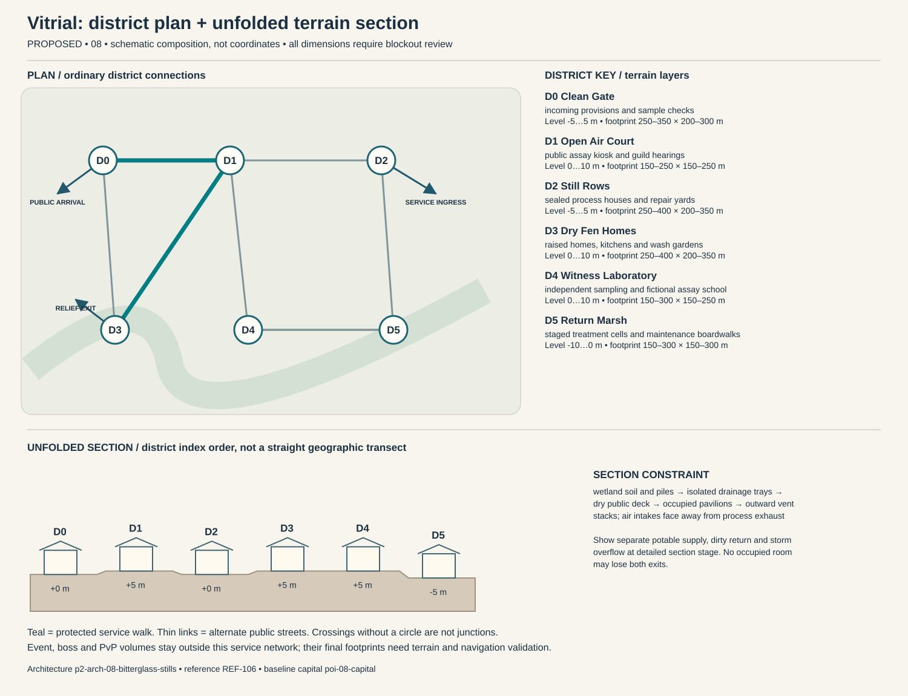

# Vitrial — capital construction blueprint

Status: PROPOSED. Sources: P2-SRC-FOUNDATION, P2-SRC-DIRECTIVE, P2-SRC-PROPOSAL. Capital ID poi-08-capital; region region-08. [Baseline dossier](https://github.com/jrmoyler/Aetherion-The-Fifteen-Oaths/tree/5dce9edae0bb3587eb7c72433395e7d5a19857ea/AETHERION_CANON/04_OATH_DOSSIERS/08_BITTERGLASS_GUILD.md). This plan refines the foundation; it is not an implemented city.

## Site and provisional dimensions

Vitrial combines sealed greenhouse districts with open civic air corridors. Vent stacks, wash stations and independent sampling kiosks are visible civic infrastructure, preventing the poison realm from becoming an implausibly uninhabitable toxic city.

Plan form: compartmented wetland pavilions on a clean-air boardwalk grid. Orientation: clean upstream intake to monitored downstream treatment; dry cross-grid separates flows. Target outer envelope 1400 × 1000 m; target maximum internal relief 10 m. All metres are provisional blockout targets. District rectangles overlap in vertical layers; they are envelopes, not cadastral parcels. Final terrain, grades, route lengths, capacity, accessibility and simulation require validation. Relative heights establish a first section for critique, not automatic street grades. Where an adjacency changes height, insert a validated ordinary ramp, conventional lift with evacuation fallback, or contour path; reject infeasible ramps rather than hiding them behind magic.

## District program and adjacency

Districts follow local functions and physical constraints. They are not independent towns, equal-population wards or asset-count quotas. Edges below are undirected public links, separate from optional shortcuts.

### Clean Gate (p2-district-08-clean-gate)

Function: incoming provisions and sample checks. Functional envelope range 250–350 m wide × 200–300 m deep; relative terrain layer -5 to 5 m. This range follows the work, civic or household program and is not a property boundary. Direct neighbors: Open Air Court, Dry Fen Homes. Keep two independently signed public entries. Main thresholds show purpose and service availability before entry; private work yards cannot become a compulsory through-route. Use p2-arch-08-bitterglass-stills; fixtures follow the district function rather than generic elemental decoration.

### Open Air Court (p2-district-08-open-air-court)

Function: public assay kiosk and guild hearings. Functional envelope range 150–250 m wide × 150–250 m deep; relative terrain layer 0 to 10 m. This range follows the work, civic or household program and is not a property boundary. Direct neighbors: Clean Gate, Still Rows, Witness Laboratory, Dry Fen Homes. Keep two independently signed public entries. Main thresholds show purpose and service availability before entry; private work yards cannot become a compulsory through-route. Use p2-arch-08-bitterglass-stills; fixtures follow the district function rather than generic elemental decoration.

### Still Rows (p2-district-08-still-rows)

Function: sealed process houses and repair yards. Functional envelope range 250–400 m wide × 200–350 m deep; relative terrain layer -5 to 5 m. This range follows the work, civic or household program and is not a property boundary. Direct neighbors: Open Air Court, Return Marsh. Keep two independently signed public entries. Main thresholds show purpose and service availability before entry; private work yards cannot become a compulsory through-route. Use p2-arch-08-bitterglass-stills; fixtures follow the district function rather than generic elemental decoration.

### Dry Fen Homes (p2-district-08-dry-fen-homes)

Function: raised homes, kitchens and wash gardens. Functional envelope range 250–400 m wide × 200–350 m deep; relative terrain layer 0 to 10 m. This range follows the work, civic or household program and is not a property boundary. Direct neighbors: Open Air Court, Clean Gate. Keep two independently signed public entries. Main thresholds show purpose and service availability before entry; private work yards cannot become a compulsory through-route. Use p2-arch-08-bitterglass-stills; fixtures follow the district function rather than generic elemental decoration.

### Witness Laboratory (p2-district-08-witness-laboratory)

Function: independent sampling and fictional assay school. Functional envelope range 150–300 m wide × 150–250 m deep; relative terrain layer 0 to 10 m. This range follows the work, civic or household program and is not a property boundary. Direct neighbors: Return Marsh, Open Air Court, Return Marsh. Keep two independently signed public entries. Main thresholds show purpose and service availability before entry; private work yards cannot become a compulsory through-route. Use p2-arch-08-bitterglass-stills; fixtures follow the district function rather than generic elemental decoration.

### Return Marsh (p2-district-08-return-marsh)

Function: staged treatment cells and maintenance boardwalks. Functional envelope range 150–300 m wide × 150–300 m deep; relative terrain layer -10 to 0 m. This range follows the work, civic or household program and is not a property boundary. Direct neighbors: Still Rows, Witness Laboratory, Witness Laboratory. Keep two independently signed public entries. Main thresholds show purpose and service availability before entry; private work yards cannot become a compulsory through-route. Use p2-arch-08-bitterglass-stills; fixtures follow the district function rather than generic elemental decoration.

## Drawn plan and section

The diagram shows the actual district graph, separate public/logistics/relief entry points and the proposed terrain layers. Plan positions are diagram units, not map coordinates. The lower section unfolds the district sequence for inspection; it does not imply that every district is collinear. Terrain layer bands need site survey and accessible connecting paths.

## Streets, gates and access

Primary public arrival at Clean Gate; separate logistics gate serves Still Rows; an independently signed relief approach reaches Dry Fen Homes. These are three conceptual connections pending placement. Arrival should reveal one civic landmark and a legible next decision, not every district at once. Public links target 5 m clear width, widened to 8 m at gate connections; test these with the eventual actor, cart and crowd envelopes. Ordinary door and assisted-route clearances must be measured in engine. Alternate paths need contrasting landmarks, not just different colored arrows.

## Service spine and logistics

provisions stay on dry clean boardwalk; waste enters sealed service lanes; sampled output waits in labeled holding tanks; treatment cannot magically erase unlimited load. The protected route is Clean Gate → Open Air Court → Dry Fen Homes. It connects arrival services, civic counters and stable housing. Potable intake, process return and storm overflow cross only through inspectable sealed structures. Waste collection schedules avoid food queues; relief stores can be served with the specialist district closed. Event and territory states may change scenery or throughput but not remove this spine.

## Evacuation and failure paths

Each district has at least two graph exits. Walk outward via the shorter open graph arc to Clean Gate; if its external approach fails, use the protected housing-side relief exit at Dry Fen Homes. Never send residents through poi-08-event, p2-poi-08-worldboss or p2-poi-08-pvp. Dedicated staff move services before hazard closure. Two distinct external receiving points must be mapped before terrain lock. A biconnected district graph is only a paper check: hazard volumes, blocked doors, crowd congestion and external approach failures require independent runtime tests. Outpost warnings activate before gates close; first responders have a separate marked lane. Forced reset returns a visitor to the stable arrival refuge rather than an active hazard.

## Enterable interiors

- p2-poi-08-public-record-room: hearing desk, appeal archive, quiet waiting niche; target clear envelope 18 × 14 m. Public vestibule and independent service door; no key or hostile-state trap on the public route. Staff rotate; closed counters expose a staffed fallback kiosk without opening private storage.
- p2-poi-08-repair-interior: bench, supervised public tool rack, material store, separate waste exit; target clear envelope 24 × 18 m. Public vestibule and independent service door; no key or hostile-state trap on the public route. Staff rotate; closed counters expose a staffed fallback kiosk without opening private storage.
- p2-poi-08-watch-refuge: rotating guard station, civilian refuge, emergency stores, two exit doors; target clear envelope 22 × 16 m. Public vestibule and independent service door; no key or hostile-state trap on the public route. Staff rotate; closed counters expose a staffed fallback kiosk without opening private storage.

Housing: p2-poi-08-housing, entered from Dry Fen Homes. Sample 12 × 10 m room and 4 × 3 m entrance/storage vestibule are test envelopes. Preserve safe storage access, permissions, and recovery independent of the external facade. Homes use clean courtyards, separate workshop drains and optional certified laboratory modules. Player crafting cannot leak persistent hazards into neighboring plots or turn public sanitation into a griefing mechanic.

## Vertical cross-section and underground

wetland soil and piles → isolated drainage trays → dry public deck → occupied pavilions → outward vent stacks; air intakes face away from process exhaust. Occupied rooms need inspectable drainage/ventilation appropriate to their layer. Section drawings must show foundations, habitable floors, overhead loading, water and evacuation, not only a skyline.

Dungeon approach: wash vestibule → protected worker refuge → isolated still chamber → dependency archive → clean-side exit. The threshold to poi-08-dungeon is a signed, separate admission zone; public utility access does not flag a party into combat. The secret p2-poi-08-secret is optional and never hides the only exit.

## Institutions, livelihoods and defense

Laboratory houses hold a guild charter, but resident councils and independent testers can challenge permits. The dramatic conflict is whether affected communities can fund evidence when the accused laboratories own most instruments. Public assay days, shared washhouses and transparent labeling are civic rituals. Covenant duty is disclosure of known risks and participation in remediation, with protection for whistleblowers rather than compulsory self-experimentation. The gate watch uses p2-poi-08-watch-refuge with civilian refuge space protected from equipment loading. Specialist schools and care at Witness Laboratory have public counters; disputes affect negotiated services instead of magically disabling the whole city. Trade requires fuel, food, precision vessels and exports medicines, testing, glass, reagents. Regional villages and the exchange settlement supply daily evidence of these dependencies.

## Sacred and commemorative space

Clear Vessel Niche in Open Air Court is a voluntary sacred/commemorative Oath space: a symbolic rinsed-glass remembrance display for care labor and preventable harms; no ingestion or chemical rite. It occupies an accessible alcove or court inside the existing civic district, so it adds a distinct purpose without inventing another settlement. The ordinary public entrance remains open to unbound visitors, observers and dissenters; no prayer, ritual, ancestry, faction standing or Oath binding is required for civic services. A quiet side exit and nonparticipatory route preserve choice. Objects left here are authored story props, not automatic transfers of player possessions.

## Day/night, weather and NPC circulation

Dawn independent sampling precedes batches; noon markets use open air; night maintenance locks compartments one at a time. Still air halts high-vent process scenes; heavy rain diverts excess into bounded holding cells while residents retain clean-water access.

Anchor existing character-08-leader to scheduled hearings at Open Air Court; character-08-civilian moves between specialist work at Still Rows, public testimony and home/rest without being respawned as another identity. New background roles are role slots, not invented named protagonists: village producer → exchange store → home; porter → gate → workshop → break; watch → outpost → relief → rest; custodian → institution → service lane. Dawn independent sampling precedes batches; noon markets use open air; night maintenance locks compartments one at a time. During hazards, interrupt into warn/escort/refuge before resuming; bound simulation off-screen and never require a precise real-time appointment for story access.

Soft glass taps, vent pressure and deliberate work calls contrast with marsh insects and market bargaining. Hazard alarms have distinct patterns and captions, with reduced haze options preserving both safety and atmosphere. Alarm priority must override ambient masking without requiring hearing. Night lighting preserves route shape, household quiet and silhouette contrast; optional magic does not replace ordinary lamps, signs and staff.

## Event, world-boss and PvP interfaces

poi-08-event retains the baseline event catchment. Relief deployment goes to p2-district-08-clean-gate before closures; p2-poi-08-worldboss stays outside homes and the service loop. p2-poi-08-pvp has a separate explicit opt-in entry and two withdrawal routes. A public procession can alter traffic through a predeclared loop; no event may consume both external receiving points. Homes retain interior/storage state and safe return.

## Reference and asset handoff

Architecture kit: p2-arch-08-bitterglass-stills; art guide art-guide-08; recovered reference REF-106. Verified foundation observation: Greenhouse arcades, isolated reaction towers and bounded treatment pools. Materials observed in the foundation: oilskin, leather, pitted brass, sealed glass. New layouts translate that language into use-specific load paths and service fixtures; the reference is not proof of exact dimensions, unseen surfaces or individual production approval. Kit substitutions need an explicit compatibility and silhouette review.

## Construction phasing

1. P0: survey foundations, catchments and exclusion volumes; establish ordinary external route and temporary clean-water/refuge services.
2. P1: block out all district graph edges and two external refuge exits; reject any disconnected essential-service layout before visual work.
3. P2: build load-bearing kit, drainage, service separation, residential sample and three enterable service interiors; prove normal day/night paths.
4. P3: add optional vertical/special-Oath paths, bounded dungeon transitions, event closure overlays and habitat/resource margins without replacing public routes.
5. P4: add reference-reviewed material detail, sound and NPC routines; run disaster, accessibility, housing recovery and reduced-effects tests; obtain human signoff.

## Acceptance gates

- Graph remains connected after any one district-link closure; independently test external egress and no-Oath traversal in blockout.
- Deliver food, waste, emergency care and freight without entering optional PvP or a live boss footprint.
- Each occupied interior exposes two distinct exits and a stable safe return point.
- Change day/night, event recovery and territorial presentation without relocating protected service/housing IDs.
- Validate real gradients, sightlines, support, crowd capacity, collision, nav and render costs before claiming production readiness.

No asset count, population, street capacity, engineering safety, travel time or performance target is approved by this document. Validate the lean ordinary city first; only then add spectacle layers.
