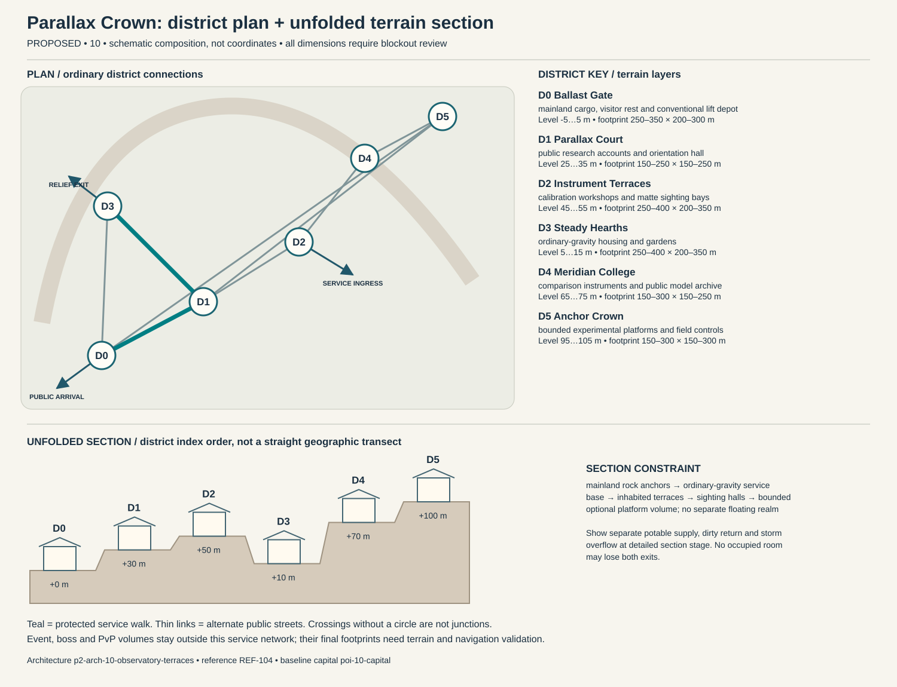

# Parallax Crown — capital construction blueprint

Status: PROPOSED. Sources: P2-SRC-FOUNDATION, P2-SRC-DIRECTIVE, P2-SRC-PROPOSAL. Capital ID poi-10-capital; region region-10. [Baseline dossier](https://github.com/jrmoyler/Aetherion-The-Fifteen-Oaths/tree/5dce9edae0bb3587eb7c72433395e7d5a19857ea/AETHERION_CANON/04_OATH_DOSSIERS/10_TIDAL_OBSERVATORY.md). This plan refines the foundation; it is not an implemented city.

## Site and provisional dimensions

Parallax Crown occupies an eastern headland with anchored observatories and limited suspended platforms. The platforms do not form a separate island realm; redundant mainland stairs and lifts preserve the continent's connected geography.

Plan form: anchored headland terraces with isolated experimental platforms. Orientation: mainland stair-and-ramp spine climbs from maintenance base to sighting crown. Target outer envelope 1500 × 800 m; target maximum internal relief 100 m. All metres are provisional blockout targets. District rectangles overlap in vertical layers; they are envelopes, not cadastral parcels. Final terrain, grades, route lengths, capacity, accessibility and simulation require validation. Relative heights establish a first section for critique, not automatic street grades. Where an adjacency changes height, insert a validated ordinary ramp, conventional lift with evacuation fallback, or contour path; reject infeasible ramps rather than hiding them behind magic.

## District program and adjacency

Districts follow local functions and physical constraints. They are not independent towns, equal-population wards or asset-count quotas. Edges below are undirected public links, separate from optional shortcuts.

### Ballast Gate (p2-district-10-ballast-gate)

Function: mainland cargo, visitor rest and conventional lift depot. Functional envelope range 250–350 m wide × 200–300 m deep; relative terrain layer -5 to 5 m. This range follows the work, civic or household program and is not a property boundary. Direct neighbors: Parallax Court, Steady Hearths, Anchor Crown. Keep two independently signed public entries. Main thresholds show purpose and service availability before entry; private work yards cannot become a compulsory through-route. Use p2-arch-10-observatory-terraces; fixtures follow the district function rather than generic elemental decoration.

### Parallax Court (p2-district-10-parallax-court)

Function: public research accounts and orientation hall. Functional envelope range 150–250 m wide × 150–250 m deep; relative terrain layer 25 to 35 m. This range follows the work, civic or household program and is not a property boundary. Direct neighbors: Ballast Gate, Instrument Terraces, Anchor Crown, Steady Hearths. Keep two independently signed public entries. Main thresholds show purpose and service availability before entry; private work yards cannot become a compulsory through-route. Use p2-arch-10-observatory-terraces; fixtures follow the district function rather than generic elemental decoration.

### Instrument Terraces (p2-district-10-instrument-terraces)

Function: calibration workshops and matte sighting bays. Functional envelope range 250–400 m wide × 200–350 m deep; relative terrain layer 45 to 55 m. This range follows the work, civic or household program and is not a property boundary. Direct neighbors: Parallax Court, Meridian College. Keep two independently signed public entries. Main thresholds show purpose and service availability before entry; private work yards cannot become a compulsory through-route. Use p2-arch-10-observatory-terraces; fixtures follow the district function rather than generic elemental decoration.

### Steady Hearths (p2-district-10-steady-hearths)

Function: ordinary-gravity housing and gardens. Functional envelope range 250–400 m wide × 200–350 m deep; relative terrain layer 5 to 15 m. This range follows the work, civic or household program and is not a property boundary. Direct neighbors: Parallax Court, Ballast Gate. Keep two independently signed public entries. Main thresholds show purpose and service availability before entry; private work yards cannot become a compulsory through-route. Use p2-arch-10-observatory-terraces; fixtures follow the district function rather than generic elemental decoration.

### Meridian College (p2-district-10-meridian-college)

Function: comparison instruments and public model archive. Functional envelope range 150–300 m wide × 150–250 m deep; relative terrain layer 65 to 75 m. This range follows the work, civic or household program and is not a property boundary. Direct neighbors: Instrument Terraces, Anchor Crown. Keep two independently signed public entries. Main thresholds show purpose and service availability before entry; private work yards cannot become a compulsory through-route. Use p2-arch-10-observatory-terraces; fixtures follow the district function rather than generic elemental decoration.

### Anchor Crown (p2-district-10-anchor-crown)

Function: bounded experimental platforms and field controls. Functional envelope range 150–300 m wide × 150–300 m deep; relative terrain layer 95 to 105 m. This range follows the work, civic or household program and is not a property boundary. Direct neighbors: Meridian College, Parallax Court, Ballast Gate. Keep two independently signed public entries. Main thresholds show purpose and service availability before entry; private work yards cannot become a compulsory through-route. Use p2-arch-10-observatory-terraces; fixtures follow the district function rather than generic elemental decoration.

## Drawn plan and section

The diagram shows the actual district graph, separate public/logistics/relief entry points and the proposed terrain layers. Plan positions are diagram units, not map coordinates. The lower section unfolds the district sequence for inspection; it does not imply that every district is collinear. Terrain layer bands need site survey and accessible connecting paths.

## Streets, gates and access

Primary public arrival at Ballast Gate; separate logistics gate serves Instrument Terraces; an independently signed relief approach reaches Steady Hearths. These are three conceptual connections pending placement. Arrival should reveal one civic landmark and a legible next decision, not every district at once. Public links target 5 m clear width, widened to 8 m at gate connections; test these with the eventual actor, cart and crowd envelopes. Ordinary door and assisted-route clearances must be measured in engine. Alternate paths need contrasting landmarks, not just different colored arrows.

## Service spine and logistics

heavy ballast stays low until inspected; food never crosses experimental platforms; conventional lifts have a mainland stair-and-ramp substitute. The protected route is Ballast Gate → Parallax Court → Steady Hearths. It connects arrival services, civic counters and stable housing. Potable intake, process return and storm overflow cross only through inspectable sealed structures. Waste collection schedules avoid food queues; relief stores can be served with the specialist district closed. Event and territory states may change scenery or throughput but not remove this spine.

## Evacuation and failure paths

Each district has at least two graph exits. Walk outward via the shorter open graph arc to Ballast Gate; if its external approach fails, use the protected housing-side relief exit at Steady Hearths. Never send residents through poi-10-event, p2-poi-10-worldboss or p2-poi-10-pvp. Dedicated staff move services before hazard closure. Two distinct external receiving points must be mapped before terrain lock. A biconnected district graph is only a paper check: hazard volumes, blocked doors, crowd congestion and external approach failures require independent runtime tests. Outpost warnings activate before gates close; first responders have a separate marked lane. Forced reset returns a visitor to the stable arrival refuge rather than an active hazard.

## Enterable interiors

- p2-poi-10-public-record-room: hearing desk, appeal archive, quiet waiting niche; target clear envelope 18 × 14 m. Public vestibule and independent service door; no key or hostile-state trap on the public route. Staff rotate; closed counters expose a staffed fallback kiosk without opening private storage.
- p2-poi-10-repair-interior: bench, supervised public tool rack, material store, separate waste exit; target clear envelope 24 × 18 m. Public vestibule and independent service door; no key or hostile-state trap on the public route. Staff rotate; closed counters expose a staffed fallback kiosk without opening private storage.
- p2-poi-10-watch-refuge: rotating guard station, civilian refuge, emergency stores, two exit doors; target clear envelope 22 × 16 m. Public vestibule and independent service door; no key or hostile-state trap on the public route. Staff rotate; closed counters expose a staffed fallback kiosk without opening private storage.

Housing: p2-poi-10-housing, entered from Steady Hearths. Sample 12 × 10 m room and 4 × 3 m entrance/storage vestibule are test envelopes. Preserve safe storage access, permissions, and recovery independent of the external facade. Homes sit mostly on stable terraces, with optional anchored observation decks. Gravity customization is bounded inside housing instances and cannot alter public paths, guests' controls or neighboring plots without clear consent.

## Vertical cross-section and underground

mainland rock anchors → ordinary-gravity service base → inhabited terraces → sighting halls → bounded optional platform volume; no separate floating realm. Occupied rooms need inspectable drainage/ventilation appropriate to their layer. Section drawings must show foundations, habitable floors, overhead loading, water and evacuation, not only a skyline.

Dungeon approach: mainland instrument hall → conventional lift siding → evacuated platform control → failed calibration archive → independent mainland ramp. The threshold to poi-10-dungeon is a signed, separate admission zone; public utility access does not flag a party into combat. The secret p2-poi-10-secret is optional and never hides the only exit.

## Institutions, livelihoods and defense

Research circles publish models to a common review forum, while inhabited platform councils approve experiments affecting their homes. The institutional flaw is unequal authority between prestigious theorists and the people carrying practical risk. Public sky evenings share discoveries in accessible language, while ballast crews host practical repair schools. Civic duty is to disclose uncertainty and compensate affected communities, not to accept every experiment for the sake of progress. The gate watch uses p2-poi-10-watch-refuge with civilian refuge space protected from equipment loading. Specialist schools and care at Meridian College have public counters; disputes affect negotiated services instead of magically disabling the whole city. Trade requires food, metals, maintenance labor and exports navigation, measurement, gravity engineering. Regional villages and the exchange settlement supply daily evidence of these dependencies.

## Sacred and commemorative space

Unmeasured Sky Court in Parallax Court is a voluntary sacred/commemorative Oath space: an ordinary-gravity vigil for uncertainties and unseen lives, with shaded seating and diagrammed sky references. It occupies an accessible alcove or court inside the existing civic district, so it adds a distinct purpose without inventing another settlement. The ordinary public entrance remains open to unbound visitors, observers and dissenters; no prayer, ritual, ancestry, faction standing or Oath binding is required for civic services. A quiet side exit and nonparticipatory route preserve choice. Objects left here are authored story props, not automatic transfers of player possessions.

## Day/night, weather and NPC circulation

Dawn instruments are shuttered and cleaned; midday visitor instruction; clear nights open observation while housing light screens reduce glare. Coastal fog cancels sighting and platform use; mainland services and tactile-style guidance remain unchanged.

Anchor existing character-10-leader to scheduled hearings at Parallax Court; character-10-civilian moves between specialist work at Instrument Terraces, public testimony and home/rest without being respawned as another identity. New background roles are role slots, not invented named protagonists: village producer → exchange store → home; porter → gate → workshop → break; watch → outpost → relief → rest; custodian → institution → service lane. Dawn instruments are shuttered and cleaned; midday visitor instruction; clear nights open observation while housing light screens reduce glare. During hazards, interrupt into warn/escort/refuge before resuming; bound simulation off-screen and never require a precise real-time appointment for story access.

Slow metallic beating, instrument clicks and spacious low tones suggest measured scale. Water sounds remain incidental coastal context, keeping the Observatory audibly separate from Tidal Covenant circulation and work songs. Alarm priority must override ambient masking without requiring hearing. Night lighting preserves route shape, household quiet and silhouette contrast; optional magic does not replace ordinary lamps, signs and staff.

## Event, world-boss and PvP interfaces

poi-10-event retains the baseline event catchment. Relief deployment goes to p2-district-10-ballast-gate before closures; p2-poi-10-worldboss stays outside homes and the service loop. p2-poi-10-pvp has a separate explicit opt-in entry and two withdrawal routes. A public procession can alter traffic through a predeclared loop; no event may consume both external receiving points. Homes retain interior/storage state and safe return.

## Reference and asset handoff

Architecture kit: p2-arch-10-observatory-terraces; art guide art-guide-10; recovered reference REF-104. Verified foundation observation: Cliff observatories, orbital monuments and suspended platforms. Materials observed in the foundation: meteor iron, wool, violet enamel, brushed metal. New layouts translate that language into use-specific load paths and service fixtures; the reference is not proof of exact dimensions, unseen surfaces or individual production approval. Kit substitutions need an explicit compatibility and silhouette review.

## Construction phasing

1. P0: survey foundations, catchments and exclusion volumes; establish ordinary external route and temporary clean-water/refuge services.
2. P1: block out all district graph edges and two external refuge exits; reject any disconnected essential-service layout before visual work.
3. P2: build load-bearing kit, drainage, service separation, residential sample and three enterable service interiors; prove normal day/night paths.
4. P3: add optional vertical/special-Oath paths, bounded dungeon transitions, event closure overlays and habitat/resource margins without replacing public routes.
5. P4: add reference-reviewed material detail, sound and NPC routines; run disaster, accessibility, housing recovery and reduced-effects tests; obtain human signoff.

## Acceptance gates

- Graph remains connected after any one district-link closure; independently test external egress and no-Oath traversal in blockout.
- Deliver food, waste, emergency care and freight without entering optional PvP or a live boss footprint.
- Each occupied interior exposes two distinct exits and a stable safe return point.
- Change day/night, event recovery and territorial presentation without relocating protected service/housing IDs.
- Validate real gradients, sightlines, support, crowd capacity, collision, nav and render costs before claiming production readiness.

No asset count, population, street capacity, engineering safety, travel time or performance target is approved by this document. Validate the lean ordinary city first; only then add spectacle layers.
