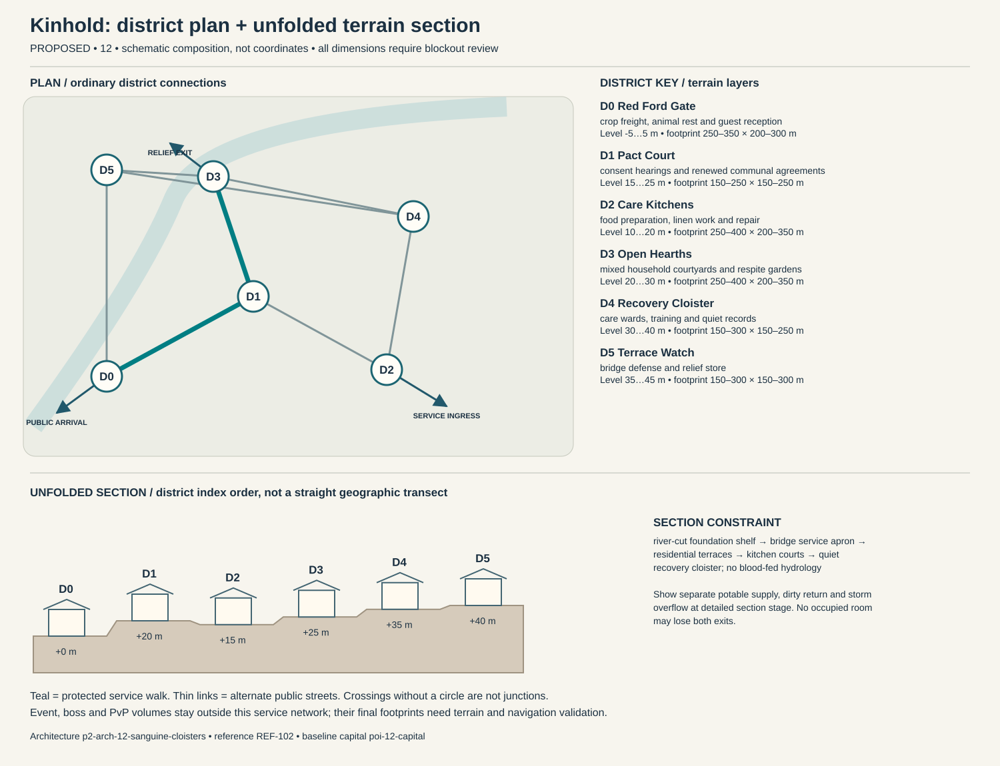

# Kinhold — capital construction blueprint

Status: PROPOSED. Sources: P2-SRC-FOUNDATION, P2-SRC-DIRECTIVE, P2-SRC-PROPOSAL. Capital ID poi-12-capital; region region-12. [Baseline dossier](https://github.com/jrmoyler/Aetherion-The-Fifteen-Oaths/tree/5dce9edae0bb3587eb7c72433395e7d5a19857ea/AETHERION_CANON/04_OATH_DOSSIERS/12_SANGUINE_COVENANT.md). This plan refines the foundation; it is not an implemented city.

## Site and provisional dimensions

Kinhold rises on red-stone terraces above an inland river crossing. Ritual halls sit beside kitchens and recovery wards, making the material work of sustaining sacrifice visible instead of presenting blood symbolism without civilian life.

Plan form: river-crossing terraces clustered around shared kitchens. Orientation: bridge-to-care stair with a parallel supply contour ramp. Target outer envelope 1300 × 1000 m; target maximum internal relief 40 m. All metres are provisional blockout targets. District rectangles overlap in vertical layers; they are envelopes, not cadastral parcels. Final terrain, grades, route lengths, capacity, accessibility and simulation require validation. Relative heights establish a first section for critique, not automatic street grades. Where an adjacency changes height, insert a validated ordinary ramp, conventional lift with evacuation fallback, or contour path; reject infeasible ramps rather than hiding them behind magic.

## District program and adjacency

Districts follow local functions and physical constraints. They are not independent towns, equal-population wards or asset-count quotas. Edges below are undirected public links, separate from optional shortcuts.

### Red Ford Gate (p2-district-12-red-ford-gate)

Function: crop freight, animal rest and guest reception. Functional envelope range 250–350 m wide × 200–300 m deep; relative terrain layer -5 to 5 m. This range follows the work, civic or household program and is not a property boundary. Direct neighbors: Pact Court, Terrace Watch. Keep two independently signed public entries. Main thresholds show purpose and service availability before entry; private work yards cannot become a compulsory through-route. Use p2-arch-12-sanguine-cloisters; fixtures follow the district function rather than generic elemental decoration.

### Pact Court (p2-district-12-pact-court)

Function: consent hearings and renewed communal agreements. Functional envelope range 150–250 m wide × 150–250 m deep; relative terrain layer 15 to 25 m. This range follows the work, civic or household program and is not a property boundary. Direct neighbors: Red Ford Gate, Care Kitchens, Open Hearths. Keep two independently signed public entries. Main thresholds show purpose and service availability before entry; private work yards cannot become a compulsory through-route. Use p2-arch-12-sanguine-cloisters; fixtures follow the district function rather than generic elemental decoration.

### Care Kitchens (p2-district-12-care-kitchens)

Function: food preparation, linen work and repair. Functional envelope range 250–400 m wide × 200–350 m deep; relative terrain layer 10 to 20 m. This range follows the work, civic or household program and is not a property boundary. Direct neighbors: Pact Court, Recovery Cloister. Keep two independently signed public entries. Main thresholds show purpose and service availability before entry; private work yards cannot become a compulsory through-route. Use p2-arch-12-sanguine-cloisters; fixtures follow the district function rather than generic elemental decoration.

### Open Hearths (p2-district-12-open-hearths)

Function: mixed household courtyards and respite gardens. Functional envelope range 250–400 m wide × 200–350 m deep; relative terrain layer 20 to 30 m. This range follows the work, civic or household program and is not a property boundary. Direct neighbors: Recovery Cloister, Pact Court, Terrace Watch. Keep two independently signed public entries. Main thresholds show purpose and service availability before entry; private work yards cannot become a compulsory through-route. Use p2-arch-12-sanguine-cloisters; fixtures follow the district function rather than generic elemental decoration.

### Recovery Cloister (p2-district-12-recovery-cloister)

Function: care wards, training and quiet records. Functional envelope range 150–300 m wide × 150–250 m deep; relative terrain layer 30 to 40 m. This range follows the work, civic or household program and is not a property boundary. Direct neighbors: Care Kitchens, Open Hearths, Terrace Watch. Keep two independently signed public entries. Main thresholds show purpose and service availability before entry; private work yards cannot become a compulsory through-route. Use p2-arch-12-sanguine-cloisters; fixtures follow the district function rather than generic elemental decoration.

### Terrace Watch (p2-district-12-terrace-watch)

Function: bridge defense and relief store. Functional envelope range 150–300 m wide × 150–300 m deep; relative terrain layer 35 to 45 m. This range follows the work, civic or household program and is not a property boundary. Direct neighbors: Red Ford Gate, Recovery Cloister, Open Hearths. Keep two independently signed public entries. Main thresholds show purpose and service availability before entry; private work yards cannot become a compulsory through-route. Use p2-arch-12-sanguine-cloisters; fixtures follow the district function rather than generic elemental decoration.

## Drawn plan and section

The diagram shows the actual district graph, separate public/logistics/relief entry points and the proposed terrain layers. Plan positions are diagram units, not map coordinates. The lower section unfolds the district sequence for inspection; it does not imply that every district is collinear. Terrain layer bands need site survey and accessible connecting paths.

## Streets, gates and access

Primary public arrival at Red Ford Gate; separate logistics gate serves Care Kitchens; an independently signed relief approach reaches Open Hearths. These are three conceptual connections pending placement. Arrival should reveal one civic landmark and a legible next decision, not every district at once. Public links target 5 m clear width, widened to 8 m at gate connections; test these with the eventual actor, cart and crowd envelopes. Ordinary door and assisted-route clearances must be measured in engine. Alternate paths need contrasting landmarks, not just different colored arrows.

## Service spine and logistics

food carts climb a contour ramp directly to Care Kitchens; linen and waste routes separate; guard rotations cannot consume the whole care staff. The protected route is Red Ford Gate → Pact Court → Open Hearths. It connects arrival services, civic counters and stable housing. Potable intake, process return and storm overflow cross only through inspectable sealed structures. Waste collection schedules avoid food queues; relief stores can be served with the specialist district closed. Event and territory states may change scenery or throughput but not remove this spine.

## Evacuation and failure paths

Each district has at least two graph exits. Walk outward via the shorter open graph arc to Red Ford Gate; if its external approach fails, use the protected housing-side relief exit at Open Hearths. Never send residents through poi-12-event, p2-poi-12-worldboss or p2-poi-12-pvp. Dedicated staff move services before hazard closure. Two distinct external receiving points must be mapped before terrain lock. A biconnected district graph is only a paper check: hazard volumes, blocked doors, crowd congestion and external approach failures require independent runtime tests. Outpost warnings activate before gates close; first responders have a separate marked lane. Forced reset returns a visitor to the stable arrival refuge rather than an active hazard.

## Enterable interiors

- p2-poi-12-public-record-room: hearing desk, appeal archive, quiet waiting niche; target clear envelope 18 × 14 m. Public vestibule and independent service door; no key or hostile-state trap on the public route. Staff rotate; closed counters expose a staffed fallback kiosk without opening private storage.
- p2-poi-12-repair-interior: bench, supervised public tool rack, material store, separate waste exit; target clear envelope 24 × 18 m. Public vestibule and independent service door; no key or hostile-state trap on the public route. Staff rotate; closed counters expose a staffed fallback kiosk without opening private storage.
- p2-poi-12-watch-refuge: rotating guard station, civilian refuge, emergency stores, two exit doors; target clear envelope 22 × 16 m. Public vestibule and independent service door; no key or hostile-state trap on the public route. Staff rotate; closed counters expose a staffed fallback kiosk without opening private storage.

Housing: p2-poi-12-housing, entered from Open Hearths. Sample 12 × 10 m room and 4 × 3 m entrance/storage vestibule are test envelopes. Preserve safe storage access, permissions, and recovery independent of the external facade. Housing includes multi-household courts, private withdrawal rooms and guest rights for chosen kin. Players can join communal homes without granting others control of their character, inventory or ability to leave.

## Vertical cross-section and underground

river-cut foundation shelf → bridge service apron → residential terraces → kitchen courts → quiet recovery cloister; no blood-fed hydrology. Occupied rooms need inspectable drainage/ventilation appropriate to their layer. Section drawings must show foundations, habitable floors, overhead loading, water and evacuation, not only a skyline.

Dungeon approach: public care receiving room → ritual interface gallery → disputed records → replacement care junction → recovery-side exit. The threshold to poi-12-dungeon is a signed, separate admission zone; public utility access does not flag a party into combat. The secret p2-poi-12-secret is optional and never hides the only exit.

## Institutions, livelihoods and defense

Kin assemblies oversee communal care while consent tribunals review new and inherited pacts. Leaders disagree whether a descendant may end an obligation whose benefits still support others, making transition funding central to reform. Communal meals, chosen-kin ceremonies and recorded care commitments organize daily life. Covenant duty must specify scope, duration and withdrawal terms; coercive inheritance is an institution to interrogate, not an unavoidable biological destiny. The gate watch uses p2-poi-12-watch-refuge with civilian refuge space protected from equipment loading. Specialist schools and care at Recovery Cloister have public counters; disputes affect negotiated services instead of magically disabling the whole city. Trade requires medicines, tools, grain reserves and exports textiles, care networks, caravan support. Regional villages and the exchange settlement supply daily evidence of these dependencies.

## Sacred and commemorative space

Unbound Table in Pact Court is a voluntary sacred/commemorative Oath space: a shared memorial meal and voluntary renewal space; attendance never creates a pact, blood act or inherited obligation. It occupies an accessible alcove or court inside the existing civic district, so it adds a distinct purpose without inventing another settlement. The ordinary public entrance remains open to unbound visitors, observers and dissenters; no prayer, ritual, ancestry, faction standing or Oath binding is required for civic services. A quiet side exit and nonparticipatory route preserve choice. Objects left here are authored story props, not automatic transfers of player possessions.

## Day/night, weather and NPC circulation

Dawn shared cooking and care handover; noon consent hearings include respite breaks; night guard relief protects household sleep. Seasonal river rise closes the lower ford; high terrace bridge and care ramp remain the relief spine.

Anchor existing character-12-leader to scheduled hearings at Pact Court; character-12-civilian moves between specialist work at Care Kitchens, public testimony and home/rest without being respawned as another identity. New background roles are role slots, not invented named protagonists: village producer → exchange store → home; porter → gate → workshop → break; watch → outpost → relief → rest; custodian → institution → service lane. Dawn shared cooking and care handover; noon consent hearings include respite breaks; night guard relief protects household sleep. During hazards, interrupt into warn/escort/refuge before resuming; bound simulation off-screen and never require a precise real-time appointment for story access.

Measured heartlike percussion, communal singing and quiet kitchen activity humanize the region. Combat cost cues are clear and optional in intensity, avoiding constant invasive heartbeat audio or gratuitous injury emphasis. Alarm priority must override ambient masking without requiring hearing. Night lighting preserves route shape, household quiet and silhouette contrast; optional magic does not replace ordinary lamps, signs and staff.

## Event, world-boss and PvP interfaces

poi-12-event retains the baseline event catchment. Relief deployment goes to p2-district-12-red-ford-gate before closures; p2-poi-12-worldboss stays outside homes and the service loop. p2-poi-12-pvp has a separate explicit opt-in entry and two withdrawal routes. A public procession can alter traffic through a predeclared loop; no event may consume both external receiving points. Homes retain interior/storage state and safe return.

## Reference and asset handoff

Architecture kit: p2-arch-12-sanguine-cloisters; art guide art-guide-12; recovered reference REF-102. Verified foundation observation: Crimson fortresses, ritual pillars and bound ceremonial platforms. Materials observed in the foundation: oxblood leather, crimson glass/enamel, patinated iron. New layouts translate that language into use-specific load paths and service fixtures; the reference is not proof of exact dimensions, unseen surfaces or individual production approval. Kit substitutions need an explicit compatibility and silhouette review.

## Construction phasing

1. P0: survey foundations, catchments and exclusion volumes; establish ordinary external route and temporary clean-water/refuge services.
2. P1: block out all district graph edges and two external refuge exits; reject any disconnected essential-service layout before visual work.
3. P2: build load-bearing kit, drainage, service separation, residential sample and three enterable service interiors; prove normal day/night paths.
4. P3: add optional vertical/special-Oath paths, bounded dungeon transitions, event closure overlays and habitat/resource margins without replacing public routes.
5. P4: add reference-reviewed material detail, sound and NPC routines; run disaster, accessibility, housing recovery and reduced-effects tests; obtain human signoff.

## Acceptance gates

- Graph remains connected after any one district-link closure; independently test external egress and no-Oath traversal in blockout.
- Deliver food, waste, emergency care and freight without entering optional PvP or a live boss footprint.
- Each occupied interior exposes two distinct exits and a stable safe return point.
- Change day/night, event recovery and territorial presentation without relocating protected service/housing IDs.
- Validate real gradients, sightlines, support, crowd capacity, collision, nav and render costs before claiming production readiness.

No asset count, population, street capacity, engineering safety, travel time or performance target is approved by this document. Validate the lean ordinary city first; only then add spectacle layers.
