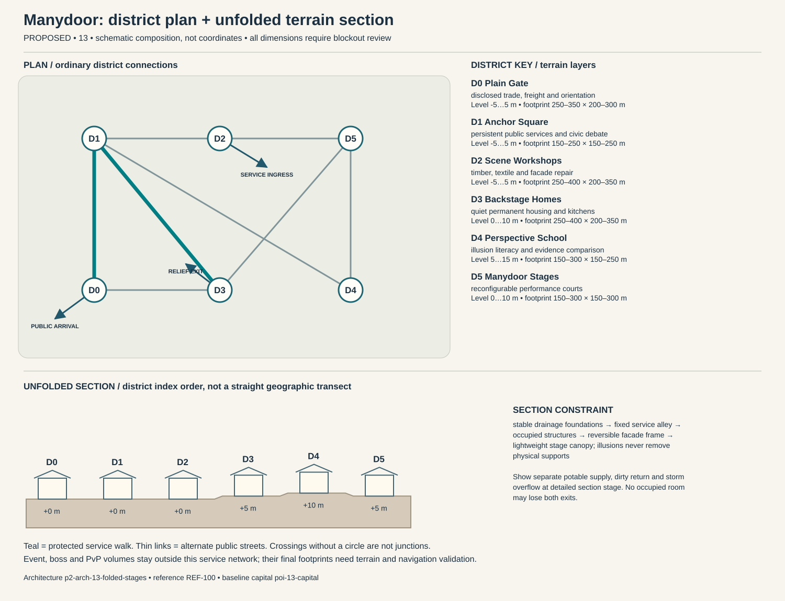

# Manydoor — capital construction blueprint

Status: PROPOSED. Sources: P2-SRC-FOUNDATION, P2-SRC-DIRECTIVE, P2-SRC-PROPOSAL. Capital ID poi-13-capital; region region-13. [Baseline dossier](https://github.com/jrmoyler/Aetherion-The-Fifteen-Oaths/tree/5dce9edae0bb3587eb7c72433395e7d5a19857ea/AETHERION_CANON/04_OATH_DOSSIERS/13_FOLDED_THEATRE.md). This plan refines the foundation; it is not an implemented city.

## Site and provisional dimensions

Manydoor grows through rearrangeable facades around a persistent structural street plan. Interior performance spaces can change within authored bounds, while hospitals, exits and public services retain recognizable anchors.

Plan form: fixed backstage grid beneath reversible performance fronts. Orientation: plain service grid crosses spectacle-facing streets at marked anchor courts. Target outer envelope 1400 × 1100 m; target maximum internal relief 10 m. All metres are provisional blockout targets. District rectangles overlap in vertical layers; they are envelopes, not cadastral parcels. Final terrain, grades, route lengths, capacity, accessibility and simulation require validation. Relative heights establish a first section for critique, not automatic street grades. Where an adjacency changes height, insert a validated ordinary ramp, conventional lift with evacuation fallback, or contour path; reject infeasible ramps rather than hiding them behind magic.

## District program and adjacency

Districts follow local functions and physical constraints. They are not independent towns, equal-population wards or asset-count quotas. Edges below are undirected public links, separate from optional shortcuts.

### Plain Gate (p2-district-13-plain-gate)

Function: disclosed trade, freight and orientation. Functional envelope range 250–350 m wide × 200–300 m deep; relative terrain layer -5 to 5 m. This range follows the work, civic or household program and is not a property boundary. Direct neighbors: Anchor Square, Backstage Homes. Keep two independently signed public entries. Main thresholds show purpose and service availability before entry; private work yards cannot become a compulsory through-route. Use p2-arch-13-folded-stages; fixtures follow the district function rather than generic elemental decoration.

### Anchor Square (p2-district-13-anchor-square)

Function: persistent public services and civic debate. Functional envelope range 150–250 m wide × 150–250 m deep; relative terrain layer -5 to 5 m. This range follows the work, civic or household program and is not a property boundary. Direct neighbors: Plain Gate, Scene Workshops, Perspective School, Backstage Homes. Keep two independently signed public entries. Main thresholds show purpose and service availability before entry; private work yards cannot become a compulsory through-route. Use p2-arch-13-folded-stages; fixtures follow the district function rather than generic elemental decoration.

### Scene Workshops (p2-district-13-scene-workshops)

Function: timber, textile and facade repair. Functional envelope range 250–400 m wide × 200–350 m deep; relative terrain layer -5 to 5 m. This range follows the work, civic or household program and is not a property boundary. Direct neighbors: Anchor Square, Manydoor Stages. Keep two independently signed public entries. Main thresholds show purpose and service availability before entry; private work yards cannot become a compulsory through-route. Use p2-arch-13-folded-stages; fixtures follow the district function rather than generic elemental decoration.

### Backstage Homes (p2-district-13-backstage-homes)

Function: quiet permanent housing and kitchens. Functional envelope range 250–400 m wide × 200–350 m deep; relative terrain layer 0 to 10 m. This range follows the work, civic or household program and is not a property boundary. Direct neighbors: Anchor Square, Plain Gate, Manydoor Stages. Keep two independently signed public entries. Main thresholds show purpose and service availability before entry; private work yards cannot become a compulsory through-route. Use p2-arch-13-folded-stages; fixtures follow the district function rather than generic elemental decoration.

### Perspective School (p2-district-13-perspective-school)

Function: illusion literacy and evidence comparison. Functional envelope range 150–300 m wide × 150–250 m deep; relative terrain layer 5 to 15 m. This range follows the work, civic or household program and is not a property boundary. Direct neighbors: Manydoor Stages, Anchor Square. Keep two independently signed public entries. Main thresholds show purpose and service availability before entry; private work yards cannot become a compulsory through-route. Use p2-arch-13-folded-stages; fixtures follow the district function rather than generic elemental decoration.

### Manydoor Stages (p2-district-13-manydoor-stages)

Function: reconfigurable performance courts. Functional envelope range 150–300 m wide × 150–300 m deep; relative terrain layer 0 to 10 m. This range follows the work, civic or household program and is not a property boundary. Direct neighbors: Scene Workshops, Perspective School, Backstage Homes. Keep two independently signed public entries. Main thresholds show purpose and service availability before entry; private work yards cannot become a compulsory through-route. Use p2-arch-13-folded-stages; fixtures follow the district function rather than generic elemental decoration.

## Drawn plan and section

The diagram shows the actual district graph, separate public/logistics/relief entry points and the proposed terrain layers. Plan positions are diagram units, not map coordinates. The lower section unfolds the district sequence for inspection; it does not imply that every district is collinear. Terrain layer bands need site survey and accessible connecting paths.

## Streets, gates and access

Primary public arrival at Plain Gate; separate logistics gate serves Scene Workshops; an independently signed relief approach reaches Backstage Homes. These are three conceptual connections pending placement. Arrival should reveal one civic landmark and a legible next decision, not every district at once. Public links target 5 m clear width, widened to 8 m at gate connections; test these with the eventual actor, cart and crowd envelopes. Ordinary door and assisted-route clearances must be measured in engine. Alternate paths need contrasting landmarks, not just different colored arrows.

## Service spine and logistics

raw materials use fixed backstage grid; audience streets never carry emergency carts; performance resets cannot relocate homes or hospitals. The protected route is Plain Gate → Anchor Square → Backstage Homes. It connects arrival services, civic counters and stable housing. Potable intake, process return and storm overflow cross only through inspectable sealed structures. Waste collection schedules avoid food queues; relief stores can be served with the specialist district closed. Event and territory states may change scenery or throughput but not remove this spine.

## Evacuation and failure paths

Each district has at least two graph exits. Walk outward via the shorter open graph arc to Plain Gate; if its external approach fails, use the protected housing-side relief exit at Backstage Homes. Never send residents through poi-13-event, p2-poi-13-worldboss or p2-poi-13-pvp. Dedicated staff move services before hazard closure. Two distinct external receiving points must be mapped before terrain lock. A biconnected district graph is only a paper check: hazard volumes, blocked doors, crowd congestion and external approach failures require independent runtime tests. Outpost warnings activate before gates close; first responders have a separate marked lane. Forced reset returns a visitor to the stable arrival refuge rather than an active hazard.

## Enterable interiors

- p2-poi-13-public-record-room: hearing desk, appeal archive, quiet waiting niche; target clear envelope 18 × 14 m. Public vestibule and independent service door; no key or hostile-state trap on the public route. Staff rotate; closed counters expose a staffed fallback kiosk without opening private storage.
- p2-poi-13-repair-interior: bench, supervised public tool rack, material store, separate waste exit; target clear envelope 24 × 18 m. Public vestibule and independent service door; no key or hostile-state trap on the public route. Staff rotate; closed counters expose a staffed fallback kiosk without opening private storage.
- p2-poi-13-watch-refuge: rotating guard station, civilian refuge, emergency stores, two exit doors; target clear envelope 22 × 16 m. Public vestibule and independent service door; no key or hostile-state trap on the public route. Staff rotate; closed counters expose a staffed fallback kiosk without opening private storage.

Housing: p2-poi-13-housing, entered from Backstage Homes. Sample 12 × 10 m room and 4 × 3 m entrance/storage vestibule are test envelopes. Preserve safe storage access, permissions, and recovery independent of the external facade. Homes offer reversible visual themes over a stable collision layout. Guests can choose a plain-surface mode, and decorative illusions cannot conceal exits, hazardous furniture or the actual permissions governing a shared room.

## Vertical cross-section and underground

stable drainage foundations → fixed service alley → occupied structures → reversible facade frame → lightweight stage canopy; illusions never remove physical supports. Occupied rooms need inspectable drainage/ventilation appropriate to their layer. Section drawings must show foundations, habitable floors, overhead loading, water and evacuation, not only a skyline.

Dungeon approach: fixed backstage entrance → competing future wings → occupied refuge set → patron archive → plain anchor exit. The threshold to poi-13-dungeon is a signed, separate admission zone; public utility access does not flag a party into combat. The secret p2-poi-13-secret is optional and never hides the only exit.

## Institutions, livelihoods and defense

District troupes share a civic stage charter, while plain-surface inspectors certify essential routes and contracts. The central conflict is whether those inspectors protect consent or merely enforce the tastes of established patrons. Residents celebrate rehearsal, costume exchange and public disclosure of staged experiences. Covenant duty is to mark consequential illusions and preserve informed exit, while political patrons seek exceptions for supposedly beneficial civic myths. The gate watch uses p2-poi-13-watch-refuge with civilian refuge space protected from equipment loading. Specialist schools and care at Perspective School have public counters; disputes affect negotiated services instead of magically disabling the whole city. Trade requires food, precision materials, timber and exports performance, training simulations, illusion craft. Regional villages and the exchange settlement supply daily evidence of these dependencies.

## Sacred and commemorative space

Unmasked Interval in Anchor Square is a voluntary sacred/commemorative Oath space: a disclosed, illusion-free remembrance pause between performances where choosing not to act is honored. It occupies an accessible alcove or court inside the existing civic district, so it adds a distinct purpose without inventing another settlement. The ordinary public entrance remains open to unbound visitors, observers and dissenters; no prayer, ritual, ancestry, faction standing or Oath binding is required for civic services. A quiet side exit and nonparticipatory route preserve choice. Objects left here are authored story props, not automatic transfers of player possessions.

## Day/night, weather and NPC circulation

Morning loads arrive before audiences; afternoon rehearsal is opt-in and captioned; evening performances close in staggered sessions to protect egress. Dust gusts lower scenic cloth and close mirror panels; the plain grid remains readable without effects.

Anchor existing character-13-leader to scheduled hearings at Anchor Square; character-13-civilian moves between specialist work at Scene Workshops, public testimony and home/rest without being respawned as another identity. New background roles are role slots, not invented named protagonists: village producer → exchange store → home; porter → gate → workshop → break; watch → outpost → relief → rest; custodian → institution → service lane. Morning loads arrive before audiences; afternoon rehearsal is opt-in and captioned; evening performances close in staggered sessions to protect egress. During hazards, interrupt into warn/escort/refuge before resuming; bound simulation off-screen and never require a precise real-time appointment for story access.

Layered stage foley, audible backstage labor and deliberately shifting acoustic perspective distinguish performance spaces. Critical cues remain stable across illusions, and players can reduce overlapping voices and mirrored sound for comfort. Alarm priority must override ambient masking without requiring hearing. Night lighting preserves route shape, household quiet and silhouette contrast; optional magic does not replace ordinary lamps, signs and staff.

## Event, world-boss and PvP interfaces

poi-13-event retains the baseline event catchment. Relief deployment goes to p2-district-13-plain-gate before closures; p2-poi-13-worldboss stays outside homes and the service loop. p2-poi-13-pvp has a separate explicit opt-in entry and two withdrawal routes. A public procession can alter traffic through a predeclared loop; no event may consume both external receiving points. Homes retain interior/storage state and safe return.

## Reference and asset handoff

Architecture kit: p2-arch-13-folded-stages; art guide art-guide-13; recovered reference REF-100. Verified foundation observation: Folded screen plazas, optical gates and rearranging mirror corridors. Materials observed in the foundation: folded lacquer/enamel, cloth, old silver, faceted mirror. New layouts translate that language into use-specific load paths and service fixtures; the reference is not proof of exact dimensions, unseen surfaces or individual production approval. Kit substitutions need an explicit compatibility and silhouette review.

## Construction phasing

1. P0: survey foundations, catchments and exclusion volumes; establish ordinary external route and temporary clean-water/refuge services.
2. P1: block out all district graph edges and two external refuge exits; reject any disconnected essential-service layout before visual work.
3. P2: build load-bearing kit, drainage, service separation, residential sample and three enterable service interiors; prove normal day/night paths.
4. P3: add optional vertical/special-Oath paths, bounded dungeon transitions, event closure overlays and habitat/resource margins without replacing public routes.
5. P4: add reference-reviewed material detail, sound and NPC routines; run disaster, accessibility, housing recovery and reduced-effects tests; obtain human signoff.

## Acceptance gates

- Graph remains connected after any one district-link closure; independently test external egress and no-Oath traversal in blockout.
- Deliver food, waste, emergency care and freight without entering optional PvP or a live boss footprint.
- Each occupied interior exposes two distinct exits and a stable safe return point.
- Change day/night, event recovery and territorial presentation without relocating protected service/housing IDs.
- Validate real gradients, sightlines, support, crowd capacity, collision, nav and render costs before claiming production readiness.

No asset count, population, street capacity, engineering safety, travel time or performance target is approved by this document. Validate the lean ordinary city first; only then add spectacle layers.
