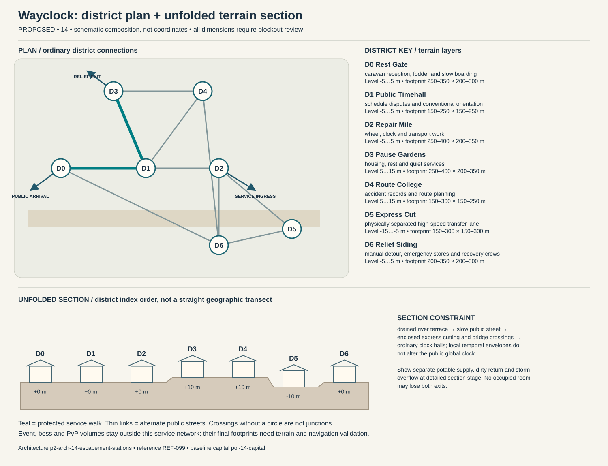

# Wayclock — capital construction blueprint

Status: PROPOSED. Sources: P2-SRC-FOUNDATION, P2-SRC-DIRECTIVE, P2-SRC-PROPOSAL. Capital ID poi-14-capital; region region-14. [Baseline dossier](https://github.com/jrmoyler/Aetherion-The-Fifteen-Oaths/tree/5dce9edae0bb3587eb7c72433395e7d5a19857ea/AETHERION_CANON/04_OATH_DOSSIERS/14_ESCAPEMENT_ROAD.md). This plan refines the foundation; it is not an implemented city.

## Site and provisional dimensions

Wayclock occupies a broad junction of roads, workshops and public timekeeping halls. Fast lanes remain physically separated from homes and markets, with conventional walkable routes that never require a mount or temporal ability.

Plan form: linear junction city with grade-separated express and resting loops. Orientation: river-terrace road forks around a central walkable timekeeping hall. Target outer envelope 2100 × 900 m; target maximum internal relief 20 m. All metres are provisional blockout targets. District rectangles overlap in vertical layers; they are envelopes, not cadastral parcels. Final terrain, grades, route lengths, capacity, accessibility and simulation require validation. Relative heights establish a first section for critique, not automatic street grades. Where an adjacency changes height, insert a validated ordinary ramp, conventional lift with evacuation fallback, or contour path; reject infeasible ramps rather than hiding them behind magic.

## District program and adjacency

Districts follow local functions and physical constraints. They are not independent towns, equal-population wards or asset-count quotas. Edges below are undirected public links, separate from optional shortcuts.

### Rest Gate (p2-district-14-rest-gate)

Function: caravan reception, fodder and slow boarding. Functional envelope range 250–350 m wide × 200–300 m deep; relative terrain layer -5 to 5 m. This range follows the work, civic or household program and is not a property boundary. Direct neighbors: Public Timehall, Relief Siding. Keep two independently signed public entries. Main thresholds show purpose and service availability before entry; private work yards cannot become a compulsory through-route. Use p2-arch-14-escapement-stations; fixtures follow the district function rather than generic elemental decoration.

### Public Timehall (p2-district-14-public-timehall)

Function: schedule disputes and conventional orientation. Functional envelope range 150–250 m wide × 150–250 m deep; relative terrain layer -5 to 5 m. This range follows the work, civic or household program and is not a property boundary. Direct neighbors: Rest Gate, Repair Mile, Pause Gardens, Route College. Keep two independently signed public entries. Main thresholds show purpose and service availability before entry; private work yards cannot become a compulsory through-route. Use p2-arch-14-escapement-stations; fixtures follow the district function rather than generic elemental decoration.

### Repair Mile (p2-district-14-repair-mile)

Function: wheel, clock and transport work. Functional envelope range 250–400 m wide × 200–350 m deep; relative terrain layer -5 to 5 m. This range follows the work, civic or household program and is not a property boundary. Direct neighbors: Public Timehall, Express Cut, Relief Siding. Keep two independently signed public entries. Main thresholds show purpose and service availability before entry; private work yards cannot become a compulsory through-route. Use p2-arch-14-escapement-stations; fixtures follow the district function rather than generic elemental decoration.

### Pause Gardens (p2-district-14-pause-gardens)

Function: housing, rest and quiet services. Functional envelope range 250–400 m wide × 200–350 m deep; relative terrain layer 5 to 15 m. This range follows the work, civic or household program and is not a property boundary. Direct neighbors: Public Timehall, Route College. Keep two independently signed public entries. Main thresholds show purpose and service availability before entry; private work yards cannot become a compulsory through-route. Use p2-arch-14-escapement-stations; fixtures follow the district function rather than generic elemental decoration.

### Route College (p2-district-14-route-college)

Function: accident records and route planning. Functional envelope range 150–300 m wide × 150–250 m deep; relative terrain layer 5 to 15 m. This range follows the work, civic or household program and is not a property boundary. Direct neighbors: Pause Gardens, Public Timehall, Relief Siding. Keep two independently signed public entries. Main thresholds show purpose and service availability before entry; private work yards cannot become a compulsory through-route. Use p2-arch-14-escapement-stations; fixtures follow the district function rather than generic elemental decoration.

### Express Cut (p2-district-14-express-cut)

Function: physically separated high-speed transfer lane. Functional envelope range 150–300 m wide × 150–300 m deep; relative terrain layer -15 to -5 m. This range follows the work, civic or household program and is not a property boundary. Direct neighbors: Repair Mile, Relief Siding. Keep two independently signed public entries. Main thresholds show purpose and service availability before entry; private work yards cannot become a compulsory through-route. Use p2-arch-14-escapement-stations; fixtures follow the district function rather than generic elemental decoration.

### Relief Siding (p2-district-14-relief-siding)

Function: manual detour, emergency stores and recovery crews. Functional envelope range 200–350 m wide × 200–300 m deep; relative terrain layer -5 to 5 m. This range follows the work, civic or household program and is not a property boundary. Direct neighbors: Express Cut, Rest Gate, Route College, Repair Mile. Keep two independently signed public entries. Main thresholds show purpose and service availability before entry; private work yards cannot become a compulsory through-route. Use p2-arch-14-escapement-stations; fixtures follow the district function rather than generic elemental decoration.

## Drawn plan and section

The diagram shows the actual district graph, separate public/logistics/relief entry points and the proposed terrain layers. Plan positions are diagram units, not map coordinates. The lower section unfolds the district sequence for inspection; it does not imply that every district is collinear. Terrain layer bands need site survey and accessible connecting paths.

## Streets, gates and access

Primary public arrival at Rest Gate; separate logistics gate serves Repair Mile; an independently signed relief approach reaches Pause Gardens. These are three conceptual connections pending placement. Arrival should reveal one civic landmark and a legible next decision, not every district at once. Public links target 5 m clear width, widened to 8 m at gate connections; test these with the eventual actor, cart and crowd envelopes. Ordinary door and assisted-route clearances must be measured in engine. Alternate paths need contrasting landmarks, not just different colored arrows.

## Service spine and logistics

caravans unload at Rest Gate; express transfers use an isolated cut; relief cargo crosses through Relief Siding at grade-separated bridges. The protected route is Rest Gate → Public Timehall → Pause Gardens. It connects arrival services, civic counters and stable housing. Potable intake, process return and storm overflow cross only through inspectable sealed structures. Waste collection schedules avoid food queues; relief stores can be served with the specialist district closed. Event and territory states may change scenery or throughput but not remove this spine.

## Evacuation and failure paths

Each district has at least two graph exits. Walk outward via the shorter open graph arc to Rest Gate; if its external approach fails, use the protected housing-side relief exit at Pause Gardens. Never send residents through poi-14-event, p2-poi-14-worldboss or p2-poi-14-pvp. Dedicated staff move services before hazard closure. Two distinct external receiving points must be mapped before terrain lock. A biconnected district graph is only a paper check: hazard volumes, blocked doors, crowd congestion and external approach failures require independent runtime tests. Outpost warnings activate before gates close; first responders have a separate marked lane. Forced reset returns a visitor to the stable arrival refuge rather than an active hazard.

## Enterable interiors

- p2-poi-14-public-record-room: hearing desk, appeal archive, quiet waiting niche; target clear envelope 18 × 14 m. Public vestibule and independent service door; no key or hostile-state trap on the public route. Staff rotate; closed counters expose a staffed fallback kiosk without opening private storage.
- p2-poi-14-repair-interior: bench, supervised public tool rack, material store, separate waste exit; target clear envelope 24 × 18 m. Public vestibule and independent service door; no key or hostile-state trap on the public route. Staff rotate; closed counters expose a staffed fallback kiosk without opening private storage.
- p2-poi-14-watch-refuge: rotating guard station, civilian refuge, emergency stores, two exit doors; target clear envelope 22 × 16 m. Public vestibule and independent service door; no key or hostile-state trap on the public route. Staff rotate; closed counters expose a staffed fallback kiosk without opening private storage.

Housing: p2-poi-14-housing, entered from Pause Gardens. Sample 12 × 10 m room and 4 × 3 m entrance/storage vestibule are test envelopes. Preserve safe storage access, permissions, and recovery independent of the external facade. Homes sit behind traffic buffers and offer workshops, stables and quiet courtyards. Time-themed decoration cannot accelerate another player's upkeep, alter real schedules or punish offline residents through fictional aging.

## Vertical cross-section and underground

drained river terrace → slow public street → enclosed express cutting and bridge crossings → ordinary clock halls; local temporal envelopes do not alter the public global clock. Occupied rooms need inspectable drainage/ventilation appropriate to their layer. Section drawings must show foundations, habitable floors, overhead loading, water and evacuation, not only a skyline.

Dungeon approach: present-day siding → repeating repair bay → trapped traveler shelter → accident record room → conventional terrace exit. The threshold to poi-14-dungeon is a signed, separate admission zone; public utility access does not flag a party into combat. The secret p2-poi-14-secret is optional and never hides the only exit.

## Institutions, livelihoods and defense

Route communes manage local roads, while a timetable assembly coordinates long-distance service. Rest guarantees and public detours limit central scheduling authority; emergency accelerations require a stated end condition and review. Communal meals follow arrivals rather than one universal clock, and public rest is a respected contribution to safety. Covenant duty includes returning borrowed motion through maintenance, not submitting every hour of life to a timetable. The gate watch uses p2-poi-14-watch-refuge with civilian refuge space protected from equipment loading. Specialist schools and care at Route College have public counters; disputes affect negotiated services instead of magically disabling the whole city. Trade requires fuel, food, structural materials and exports transport, vehicles, precision motion parts. Regional villages and the exchange settlement supply daily evidence of these dependencies.

## Sacred and commemorative space

Still Minute Shelter in Public Timehall is a voluntary sacred/commemorative Oath space: a voluntary pause for absent travelers and rest labor; its ordinary clock continues and no temporal trap is created. It occupies an accessible alcove or court inside the existing civic district, so it adds a distinct purpose without inventing another settlement. The ordinary public entrance remains open to unbound visitors, observers and dissenters; no prayer, ritual, ancestry, faction standing or Oath binding is required for civic services. A quiet side exit and nonparticipatory route preserve choice. Objects left here are authored story props, not automatic transfers of player possessions.

## Day/night, weather and NPC circulation

Dawn convoy inspection; midday staggered rest and repairs; night quiet routing uses reduced express slots with manual fallback. River rise closes low transfer decks; manual terrace detour bypasses temporal corridors and preserves boarding.

Anchor existing character-14-leader to scheduled hearings at Public Timehall; character-14-civilian moves between specialist work at Repair Mile, public testimony and home/rest without being respawned as another identity. New background roles are role slots, not invented named protagonists: village producer → exchange store → home; porter → gate → workshop → break; watch → outpost → relief → rest; custodian → institution → service lane. Dawn convoy inspection; midday staggered rest and repairs; night quiet routing uses reduced express slots with manual fallback. During hazards, interrupt into warn/escort/refuge before resuming; bound simulation off-screen and never require a precise real-time appointment for story access.

Road rhythms, distinct clock rates and long mechanical breaths create movement without constant frantic ticking. Temporal hazards have visual phase indicators, and audio can be reduced without losing essential timing information. Alarm priority must override ambient masking without requiring hearing. Night lighting preserves route shape, household quiet and silhouette contrast; optional magic does not replace ordinary lamps, signs and staff.

## Event, world-boss and PvP interfaces

poi-14-event retains the baseline event catchment. Relief deployment goes to p2-district-14-rest-gate before closures; p2-poi-14-worldboss stays outside homes and the service loop. p2-poi-14-pvp has a separate explicit opt-in entry and two withdrawal routes. A public procession can alter traffic through a predeclared loop; no event may consume both external receiving points. Homes retain interior/storage state and safe return.

## Reference and asset handoff

Architecture kit: p2-arch-14-escapement-stations; art guide art-guide-14; recovered reference REF-099. Verified foundation observation: Elevated clockwork highways, kinetic arch gates and temporal workshop bays. Materials observed in the foundation: woven cloth, leather, aged brass, smoked glass. New layouts translate that language into use-specific load paths and service fixtures; the reference is not proof of exact dimensions, unseen surfaces or individual production approval. Kit substitutions need an explicit compatibility and silhouette review.

## Construction phasing

1. P0: survey foundations, catchments and exclusion volumes; establish ordinary external route and temporary clean-water/refuge services.
2. P1: block out all district graph edges and two external refuge exits; reject any disconnected essential-service layout before visual work.
3. P2: build load-bearing kit, drainage, service separation, residential sample and three enterable service interiors; prove normal day/night paths.
4. P3: add optional vertical/special-Oath paths, bounded dungeon transitions, event closure overlays and habitat/resource margins without replacing public routes.
5. P4: add reference-reviewed material detail, sound and NPC routines; run disaster, accessibility, housing recovery and reduced-effects tests; obtain human signoff.

## Acceptance gates

- Graph remains connected after any one district-link closure; independently test external egress and no-Oath traversal in blockout.
- Deliver food, waste, emergency care and freight without entering optional PvP or a live boss footprint.
- Each occupied interior exposes two distinct exits and a stable safe return point.
- Change day/night, event recovery and territorial presentation without relocating protected service/housing IDs.
- Validate real gradients, sightlines, support, crowd capacity, collision, nav and render costs before claiming production readiness.

No asset count, population, street capacity, engineering safety, travel time or performance target is approved by this document. Validate the lean ordinary city first; only then add spectacle layers.
