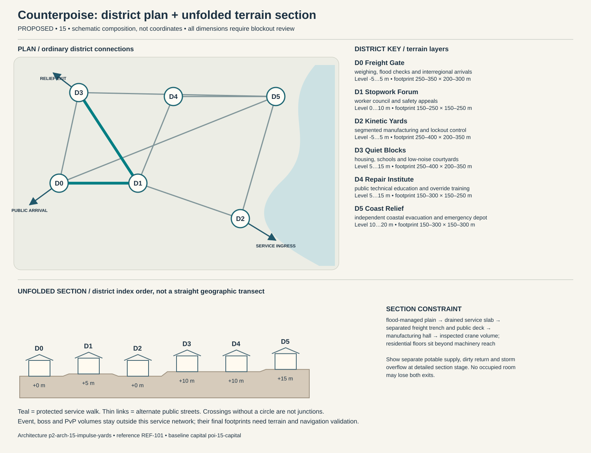

# Counterpoise — capital construction blueprint

Status: PROPOSED. Sources: P2-SRC-FOUNDATION, P2-SRC-DIRECTIVE, P2-SRC-PROPOSAL. Capital ID poi-15-capital; region region-15. [Baseline dossier](https://github.com/jrmoyler/Aetherion-The-Fifteen-Oaths/tree/5dce9edae0bb3587eb7c72433395e7d5a19857ea/AETHERION_CANON/04_OATH_DOSSIERS/15_IMPULSE_FOUNDRY.md). This plan refines the foundation; it is not an implemented city.

## Site and provisional dimensions

Counterpoise occupies the southeast coastal plain around freight yards and kinetic foundries. Heavy industry is separated from homes by service buffers and public transit, with coastal evacuation routes independent of factory command systems.

Plan form: freight plain divided by industrial buffers and an independent residential loop. Orientation: river-to-port heavy freight corridor parallel to public transit and evacuation routes. Target outer envelope 2000 × 1400 m; target maximum internal relief 15 m. All metres are provisional blockout targets. District rectangles overlap in vertical layers; they are envelopes, not cadastral parcels. Final terrain, grades, route lengths, capacity, accessibility and simulation require validation. Relative heights establish a first section for critique, not automatic street grades. Where an adjacency changes height, insert a validated ordinary ramp, conventional lift with evacuation fallback, or contour path; reject infeasible ramps rather than hiding them behind magic.

## District program and adjacency

Districts follow local functions and physical constraints. They are not independent towns, equal-population wards or asset-count quotas. Edges below are undirected public links, separate from optional shortcuts.

### Freight Gate (p2-district-15-freight-gate)

Function: weighing, flood checks and interregional arrivals. Functional envelope range 250–350 m wide × 200–300 m deep; relative terrain layer -5 to 5 m. This range follows the work, civic or household program and is not a property boundary. Direct neighbors: Stopwork Forum, Quiet Blocks, Coast Relief. Keep two independently signed public entries. Main thresholds show purpose and service availability before entry; private work yards cannot become a compulsory through-route. Use p2-arch-15-impulse-yards; fixtures follow the district function rather than generic elemental decoration.

### Stopwork Forum (p2-district-15-stopwork-forum)

Function: worker council and safety appeals. Functional envelope range 150–250 m wide × 150–250 m deep; relative terrain layer 0 to 10 m. This range follows the work, civic or household program and is not a property boundary. Direct neighbors: Freight Gate, Kinetic Yards, Repair Institute, Quiet Blocks. Keep two independently signed public entries. Main thresholds show purpose and service availability before entry; private work yards cannot become a compulsory through-route. Use p2-arch-15-impulse-yards; fixtures follow the district function rather than generic elemental decoration.

### Kinetic Yards (p2-district-15-kinetic-yards)

Function: segmented manufacturing and lockout control. Functional envelope range 250–400 m wide × 200–350 m deep; relative terrain layer -5 to 5 m. This range follows the work, civic or household program and is not a property boundary. Direct neighbors: Stopwork Forum, Coast Relief. Keep two independently signed public entries. Main thresholds show purpose and service availability before entry; private work yards cannot become a compulsory through-route. Use p2-arch-15-impulse-yards; fixtures follow the district function rather than generic elemental decoration.

### Quiet Blocks (p2-district-15-quiet-blocks)

Function: housing, schools and low-noise courtyards. Functional envelope range 250–400 m wide × 200–350 m deep; relative terrain layer 5 to 15 m. This range follows the work, civic or household program and is not a property boundary. Direct neighbors: Stopwork Forum, Freight Gate, Coast Relief. Keep two independently signed public entries. Main thresholds show purpose and service availability before entry; private work yards cannot become a compulsory through-route. Use p2-arch-15-impulse-yards; fixtures follow the district function rather than generic elemental decoration.

### Repair Institute (p2-district-15-repair-institute)

Function: public technical education and override training. Functional envelope range 150–300 m wide × 150–250 m deep; relative terrain layer 5 to 15 m. This range follows the work, civic or household program and is not a property boundary. Direct neighbors: Coast Relief, Stopwork Forum. Keep two independently signed public entries. Main thresholds show purpose and service availability before entry; private work yards cannot become a compulsory through-route. Use p2-arch-15-impulse-yards; fixtures follow the district function rather than generic elemental decoration.

### Coast Relief (p2-district-15-coast-relief)

Function: independent coastal evacuation and emergency depot. Functional envelope range 150–300 m wide × 150–300 m deep; relative terrain layer 10 to 20 m. This range follows the work, civic or household program and is not a property boundary. Direct neighbors: Kinetic Yards, Repair Institute, Quiet Blocks, Freight Gate. Keep two independently signed public entries. Main thresholds show purpose and service availability before entry; private work yards cannot become a compulsory through-route. Use p2-arch-15-impulse-yards; fixtures follow the district function rather than generic elemental decoration.

## Drawn plan and section

The diagram shows the actual district graph, separate public/logistics/relief entry points and the proposed terrain layers. Plan positions are diagram units, not map coordinates. The lower section unfolds the district sequence for inspection; it does not imply that every district is collinear. Terrain layer bands need site survey and accessible connecting paths.

## Streets, gates and access

Primary public arrival at Freight Gate; separate logistics gate serves Kinetic Yards; an independently signed relief approach reaches Quiet Blocks. These are three conceptual connections pending placement. Arrival should reveal one civic landmark and a legible next decision, not every district at once. Public links target 5 m clear width, widened to 8 m at gate connections; test these with the eventual actor, cart and crowd envelopes. Ordinary door and assisted-route clearances must be measured in engine. Alternate paths need contrasting landmarks, not just different colored arrows.

## Service spine and logistics

heavy loads stay in Kinetic Yards; public tram and food delivery use the residential loop; Coast Relief controls do not depend on factory authority. The protected route is Freight Gate → Stopwork Forum → Quiet Blocks. It connects arrival services, civic counters and stable housing. Potable intake, process return and storm overflow cross only through inspectable sealed structures. Waste collection schedules avoid food queues; relief stores can be served with the specialist district closed. Event and territory states may change scenery or throughput but not remove this spine.

## Evacuation and failure paths

Each district has at least two graph exits. Walk outward via the shorter open graph arc to Freight Gate; if its external approach fails, use the protected housing-side relief exit at Quiet Blocks. Never send residents through poi-15-event, p2-poi-15-worldboss or p2-poi-15-pvp. Dedicated staff move services before hazard closure. Two distinct external receiving points must be mapped before terrain lock. A biconnected district graph is only a paper check: hazard volumes, blocked doors, crowd congestion and external approach failures require independent runtime tests. Outpost warnings activate before gates close; first responders have a separate marked lane. Forced reset returns a visitor to the stable arrival refuge rather than an active hazard.

## Enterable interiors

- p2-poi-15-public-record-room: hearing desk, appeal archive, quiet waiting niche; target clear envelope 18 × 14 m. Public vestibule and independent service door; no key or hostile-state trap on the public route. Staff rotate; closed counters expose a staffed fallback kiosk without opening private storage.
- p2-poi-15-repair-interior: bench, supervised public tool rack, material store, separate waste exit; target clear envelope 24 × 18 m. Public vestibule and independent service door; no key or hostile-state trap on the public route. Staff rotate; closed counters expose a staffed fallback kiosk without opening private storage.
- p2-poi-15-watch-refuge: rotating guard station, civilian refuge, emergency stores, two exit doors; target clear envelope 22 × 16 m. Public vestibule and independent service door; no key or hostile-state trap on the public route. Staff rotate; closed counters expose a staffed fallback kiosk without opening private storage.

Housing: p2-poi-15-housing, entered from Quiet Blocks. Sample 12 × 10 m room and 4 × 3 m entrance/storage vestibule are test envelopes. Preserve safe storage access, permissions, and recovery independent of the external facade. Housing combines durable modular units with personal workshops and communal repair bays. Players customize cosmetic machinery without exporting noise, collision hazards or resource drains to neighbors, and event reconstruction preserves ownership and belongings.

## Vertical cross-section and underground

flood-managed plain → drained service slab → separated freight trench and public deck → manufacturing hall → inspected crane volume; residential floors sit beyond machinery reach. Occupied rooms need inspectable drainage/ventilation appropriate to their layer. Section drawings must show foundations, habitable floors, overhead loading, water and evacuation, not only a skyline.

Dungeon approach: worker reception → halted assembly lane → protected refuge → production-control chamber → independent fire-and-flood exit. The threshold to poi-15-dungeon is a signed, separate admission zone; public utility access does not flag a party into combat. The secret p2-poi-15-secret is optional and never hides the only exit.

## Institutions, livelihoods and defense

Production councils coordinate shared machinery while worker assemblies and settlement boards negotiate service priorities. Emergency command can accelerate repairs, but permanent emergency status is the central threat to civic self-government. Repair schools, communal workshops and shift kitchens support civic life. Covenant duty is to maintain and share the benefits of tools, with a protected right to challenge unsafe production orders and propose alternatives. The gate watch uses p2-poi-15-watch-refuge with civilian refuge space protected from equipment loading. Specialist schools and care at Repair Institute have public counters; disputes affect negotiated services instead of magically disabling the whole city. Trade requires ore, food, water, specialist craft and exports machinery, standardized parts, repair systems. Regional villages and the exchange settlement supply daily evidence of these dependencies.

## Sacred and commemorative space

Hands at Rest Alcove in Stopwork Forum is a voluntary sacred/commemorative Oath space: a quiet remembrance of makers and preventable injuries, with deactivated tools displayed and stop-work dignity affirmed. It occupies an accessible alcove or court inside the existing civic district, so it adds a distinct purpose without inventing another settlement. The ordinary public entrance remains open to unbound visitors, observers and dissenters; no prayer, ritual, ancestry, faction standing or Oath binding is required for civic services. A quiet side exit and nonparticipatory route preserve choice. Objects left here are authored story props, not automatic transfers of player possessions.

## Day/night, weather and NPC circulation

Dawn lockout checks and worker transport; midday shift handover slows freight; night residential buffer limits noise and emergency systems remain manual. Coastal surge interrupts port loading; elevated relief paths and inland gates remain independent of production systems.

Anchor existing character-15-leader to scheduled hearings at Stopwork Forum; character-15-civilian moves between specialist work at Kinetic Yards, public testimony and home/rest without being respawned as another identity. New background roles are role slots, not invented named protagonists: village producer → exchange store → home; porter → gate → workshop → break; watch → outpost → relief → rest; custodian → institution → service lane. Dawn lockout checks and worker transport; midday shift handover slows freight; night residential buffer limits noise and emergency systems remain manual. During hazards, interrupt into warn/escort/refuge before resuming; bound simulation off-screen and never require a precise real-time appointment for story access.

Heavy low-frequency impacts, pneumatic breath and human work calls establish scale. Safety alarms use distinct rhythms and captions, and quiet residential zones demonstrate that the city is more than an endless combat factory. Alarm priority must override ambient masking without requiring hearing. Night lighting preserves route shape, household quiet and silhouette contrast; optional magic does not replace ordinary lamps, signs and staff.

## Event, world-boss and PvP interfaces

poi-15-event retains the baseline event catchment. Relief deployment goes to p2-district-15-freight-gate before closures; p2-poi-15-worldboss stays outside homes and the service loop. p2-poi-15-pvp has a separate explicit opt-in entry and two withdrawal routes. A public procession can alter traffic through a predeclared loop; no event may consume both external receiving points. Homes retain interior/storage state and safe return.

## Reference and asset handoff

Architecture kit: p2-arch-15-impulse-yards; art guide art-guide-15; recovered reference REF-101. Verified foundation observation: Industrial rail bays, modular gantries and kinetic fortifications. Materials observed in the foundation: steel, ceramic inserts, rubber grips, heavy cloth. New layouts translate that language into use-specific load paths and service fixtures; the reference is not proof of exact dimensions, unseen surfaces or individual production approval. Kit substitutions need an explicit compatibility and silhouette review.

## Construction phasing

1. P0: survey foundations, catchments and exclusion volumes; establish ordinary external route and temporary clean-water/refuge services.
2. P1: block out all district graph edges and two external refuge exits; reject any disconnected essential-service layout before visual work.
3. P2: build load-bearing kit, drainage, service separation, residential sample and three enterable service interiors; prove normal day/night paths.
4. P3: add optional vertical/special-Oath paths, bounded dungeon transitions, event closure overlays and habitat/resource margins without replacing public routes.
5. P4: add reference-reviewed material detail, sound and NPC routines; run disaster, accessibility, housing recovery and reduced-effects tests; obtain human signoff.

## Acceptance gates

- Graph remains connected after any one district-link closure; independently test external egress and no-Oath traversal in blockout.
- Deliver food, waste, emergency care and freight without entering optional PvP or a live boss footprint.
- Each occupied interior exposes two distinct exits and a stable safe return point.
- Change day/night, event recovery and territorial presentation without relocating protected service/housing IDs.
- Validate real gradients, sightlines, support, crowd capacity, collision, nav and render costs before claiming production readiness.

No asset count, population, street capacity, engineering safety, travel time or performance target is approved by this document. Validate the lean ordinary city first; only then add spectacle layers.
