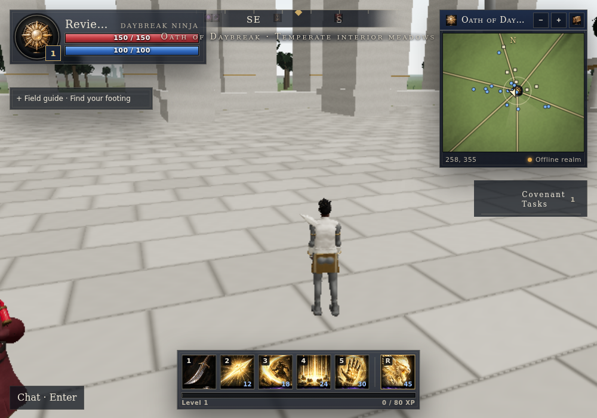

# Post-PR #11 completion

Based on merged main `1010b8f`. The prior unpushed workspace was unavailable; this branch reconstructs the identified missing work rather than claiming those bytes were recovered.

## Delivered
- Two new image-generated raster atlases: 150 distinct ability tiles plus 15 oath crests and 25 equipment/utility/discipline tiles. Stable ability-ID mapping follows custom loadouts. WebP delivery totals approximately 1.14 MiB. No reference-sheet crops in these consumers.
- Oath emblems on maps use exact atlas rectangles. Inventory art recognizes equipment categories and health versus mana consumables.
- Authored characters no longer receive duplicate rigid armor/weapon overlays; their original fitted clothing and weapon are retained. Procedural fallback weapons cover the canonical class/oath families.
- Sanctuary tables, shelves, wares, benches, light standards and colliders; animated cloth; lower arcade proportions and adjusted masonry/paving materials.
- Distant animation mixer updates honor their configured interval without discarding elapsed time.
- Touch quests and field guide occupy a shared expandable dock; collapsed chat hugs its button.
- CI includes Three.js and icon contracts; the mobile browser regression runs after Chromium installation.

## Verification
- Root tests: 246 passed after installing the runtime fixture dependencies.
- Client CI gate: 59 passed. Server tests: 50 passed.
- Production build and service-worker generation passed; both atlases included in precache.
- Onboarding passed at 320×568, 390×844 and 1440×900: native scrolling, selection, submission, no SVG and no horizontal overflow.
- Touch HUD layout passed at 390×844 and 844×390, expanded and collapsed.
- Final production gameplay smoke: skinned character loaded, movement 2.61 m, casting/cooldown passed, 78 draw calls in the sampled low-tier scene, zero SVGs, zero console/page errors and zero failed HTTP responses.

## Honest limits
The screenshot is an actual software-rendered low-tier capture, not a hardware-performance benchmark. This does not establish AAA quality, reference-exact faces/hair/architecture, or real-device/multi-client acceptance. Existing underlying character meshes remain unchanged; duplicate overlays were fixed. The missing original unpushed model/town bytes could not be recovered. The ability tiles are elemental painted vignettes, not exact depictions of every named spell's geometry.

## Art provenance
Generated with the built-in image-generation tool for this repository. Ability-sheet prompt: exact 10×15 grid; 15 elemental rows in oath order; ten distinct spell compositions (bolt, slash, burst, ward, beast, vortex, binding, shard rain, dash, cataclysm); dark painted fantasy style, no text or vector glyphs. Equipment-sheet prompt: exact 5×8 grid; fifteen ordered elemental medallions, equipment and utility items, two discipline portraits, skull, shield and key; tactile painted metal/leather/crystal, no text. Original generated PNGs were encoded as WebP for runtime delivery. Runtime paths: `game/public/ui/ability-atlas.webp`, `game/public/ui/equipment-atlas.webp`.
