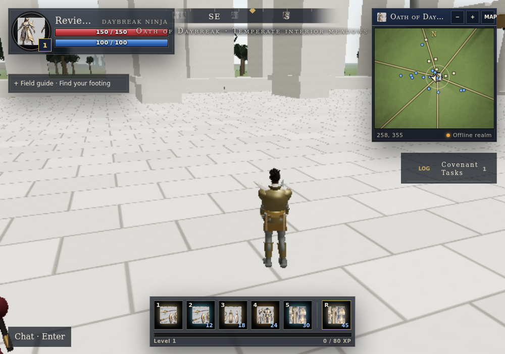
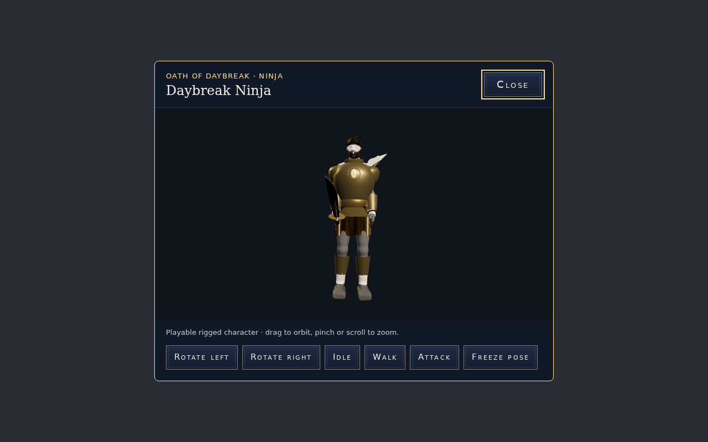
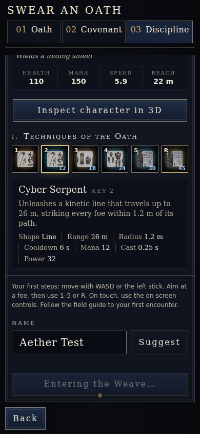

# Three.js upgrade validation

## Delivered

The shipped game now uses Three.js 0.180.0. The existing server-authoritative simulation, 150-ability catalog, progression, quests, networking, offline worker and input bindings remain in use.

- Oath onboarding: page-level touch restriction removed; single mobile pane scroll ownership; stable focus; persistent next/back controls; duplicate-submit protection; errors do not silently bypass character selection.
- No SVG in the shipped game UI, favicon, manifest or public icon assets. Authored reference art is served as 15 optimized WebP sheets totaling about 2.4 MB; these are reference illustrations, not screenshots of the playable models.
- Characters: authored GLB skeletons and animation mixers, independent materials, continuous skinned bodies, bone-fitted armor and socket weapons. Inspection and gameplay use the same body pipeline. No segmented procedural person fallback.
- World: canonical terrain heights, bounded streaming, wind-driven instanced foliage, animated water, official Three.js atmospheric scattering, synchronized daylight and bounded biome precipitation, birds, stone paving, biome-specific sanctuary structures and matching colliders.
- Combat: Three targeting/projection, authoritative cooldown reconciliation, effects for 15 forces, all 150 source palettes, bounded cleanup and isolated hit flashes.
- HUD: chat/tasks/guide start compact and expand on request.

## Verified

- Production Vite build and generated PWA service worker: pass; 31 precache entries including onboarding art.
- Root tests: 246 pass.
- Targeted combat, Three, input, progression/UI and residency tests: 29 pass.
- `node game/test/onboarding.browser.mjs`: passes 320×568, 390×844 and 1440×900; native touch swipe, correct oath/name submission, no SVG, no horizontal overflow or browser page errors.
- Production browser smoke: loaded Daybreak skinned GLB; movement changed position by 2.61 m; ability invocation produced a cooldown; 25 terrain tiles resident; zero page/console errors and zero HTTP failures. Runs in software Chromium; not a real-device FPS benchmark.
- Character inspection: model loading, walking/attack controls, skeleton/material isolation and sanitized bone/socket aliases checked.
- World geometry measurement without actors: low 118,854 triangles, medium 259,126 across resident terrain and all sanctuary structures. Drawn geometry varies with actors and camera.

## Remaining limits

This change does not establish AAA quality, photorealism, reference-art parity, or commercial readiness. Faces/hair and the underlying authored character meshes still need higher-fidelity art production. Sanctuary structures are procedural interpretations, not exact reconstructions of the reference buildings. Hardware mobile/desktop performance and all-oath visual acceptance remain unverified. Multiplayer networking contracts are preserved and unit-tested, but a live multi-client deployment was not exercised. The source review records what was actually integrated; it does not claim all 40 repositories were copied.

## Captures

Software Chromium, low graphics tier; these are actual renders, not reference artwork.

